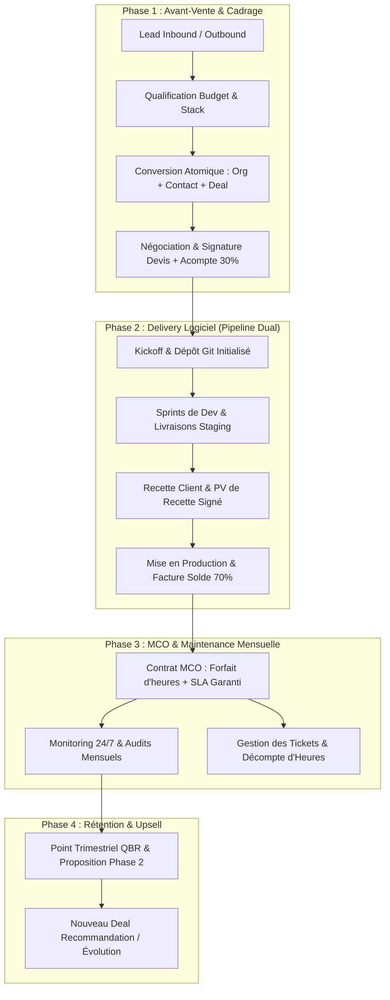

# Agency Client Lifecycle — Detailed Workflow & Architecture

> **Guide Opérationnel Détaillé & Spécifications Métier**  
> **Skill Associé** : [`agency-client-lifecycle`](SKILL.md)  
> **Exemples Concrets** : [`examples.md`](examples.md)

---

## 1. Vue d'Ensemble du Flux de Travail Studio Web

Le cycle de vie complet d'une agence web ou d'un développeur indépendant se découpe en 4 phases chronologiques étanches :



#### Équivalent Schéma ASCII :

```text
┌────────────────────────────────────────────────────────────────────────────────────────┐
│                        FLUX DE VALEUR STUDIO WEB & MCO                                 │
├────────────────────────────────────────────────────────────────────────────────────────┤
│                                                                                        │
│  [ PHASE 1 : AVANT-VENTE & CADRAGE ]                                                   │
│    Lead Inbound/Outbound ──► Qualification ──► Conversion Atomique ──► Négoc / Devis    │
│                                (Budget & Stack)  (Org + Contact + Deal) (Acompte 30%)  │
│                                                                │                       │
│                                                                ▼                       │
│  [ PHASE 2 : DELIVERY LOGICIEL ]                                                       │
│    Kickoff (Dépôt Git) ──► Sprints Dev (Staging) ──► Recette (PV Signé) ──► Production  │
│                                                                           (Solde 70%)  │
│                                                                │                       │
│                                                                ▼                       │
│  [ PHASE 3 : MCO & MAINTENANCE ]                                                       │
│    Contrat MCO (Forfait d'heures) ──► Monitoring 24/7 & Audits / Décompte Tickets       │
│                                                                │                       │
│                                                                ▼                       │
│  [ PHASE 4 : RÉTENTION & UPSELL ]                                                      │
│    Point Trimestriel QBR ──► Proposition Phase 2 / Nouveau Deal Recommandation        │
│                                                                                        │
└────────────────────────────────────────────────────────────────────────────────────────┘
```

---

## 2. Définition des Deux Pipelines Métier

### Pipeline 1 : `agency-commercial` (Avant-Vente & Signature)
| Stage ID | Nom Affiché | Probabilité | Critères d'Entrée & Sortie |
|---|---|---|---|
| `decouverte` | Prise de Contact & Cadrage | 20 % | Lead converti, besoin exprimé, budget estimé. |
| `cahier_des_charges` | Cadrage Fonctionnel | 40 % | Ateliers UX/tech menés, périmètre MVP borné. |
| `devis_envoye` | Proposition & Devis Transmis | 70 % | Chiffrage détaillé envoyé avec date limite de validité. |
| `negociation` | Ajustements & Arbitrages | 85 % | Négociation planning, stack ou variantes de scope. |
| `won` | Gagné (Contrat & Acompte 30%) | 100 % | Devis signé, acompte 30% encaissé sur le compte bancaire. |
| `lost` | Perdu / Annulé | 0 % | Débriefing consigné dans la timeline avec motif de perte. |

### Pipeline 2 : `agency-software-delivery` (Réalisation & Déploiement)
| Stage ID | Nom Affiché | Action Requise |
|---|---|---|
| `kickoff` | Lancement & Initialisation | Repo Git créé, maquettes Figma validées, environnement staging prêt. |
| `developpement` | Sprints de Développement | Développements actifs, points de démo hebdomadaires. |
| `recette` | Phase de Recette Client | Tests d'acceptance, levée des réserves bloqueuses. |
| `deploiement_prod` | Déploiement & Go-Live | Migration DNS, SSL, sauvegardes froides, facture finale 70%. |
| `cloture_projet` | Transition vers MCO | Formation équipe, remise des codes sources, bascule MCO. |

---

## 3. Matrice des Champs Personnalisés (`CustomFields`)

```text
┌─────────────────────────┬──────────────┬───────────────────────────────────────────────┐
│ Clé Custom Field        │ Type         │ Rôle Opérationnel                             │
├─────────────────────────┼──────────────┼───────────────────────────────────────────────┤
│ tech_stack              │ TEXT         │ Stack technique (ex: Django, React, Postgres) │
│ repo_url                │ TEXT         │ URL du dépôt GitHub/GitLab privé             │
│ url_staging             │ TEXT         │ URL de pré-production pour la recette client │
│ url_production          │ TEXT         │ URL publique en production                   │
│ mco_sla_level           │ CHOICE       │ standard (GTR 24h), vip (GTI 2h / GTR 8h)     │
│ mco_monthly_hours       │ INTEGER      │ Forfait d'heures mensuelles de maintenance    │
│ mco_consumed_hours      │ INTEGER      │ Heures consommées sur le mois en cours        │
│ hosting_provider        │ CHOICE       │ aws, gcp, hetzner, scaleway, vercel           │
└─────────────────────────┴──────────────┴───────────────────────────────────────────────┘
```

---

## 4. Procédure de Traitement des Incidents & Tickets MCO

1. **Réception du Ticket** : Création immédiate d'une tâche `Task` dans PyCRMKit liée au `contact` et à l'`organization` :
   - `priority="URGENT"` si anomalie bloquante de production (P1).
   - `priority="HIGH"` si anomalie majeure contournable (P2).
   - `priority="NORMAL"` si demande d'évolution ou question technique.
2. **Décompte d'Heures** : Mise à jour incrémentale du champ `mco_consumed_hours`.
3. **Journalisation dans la Timeline** : Enregistrement de l'intervention technique (`crm.timeline.record_note`).
4. **Point Trimestriel QBR (Quarterly Business Review)** : Édition du bilan d'heures et proposition de refactoring ou de sprint d'évolutions.
