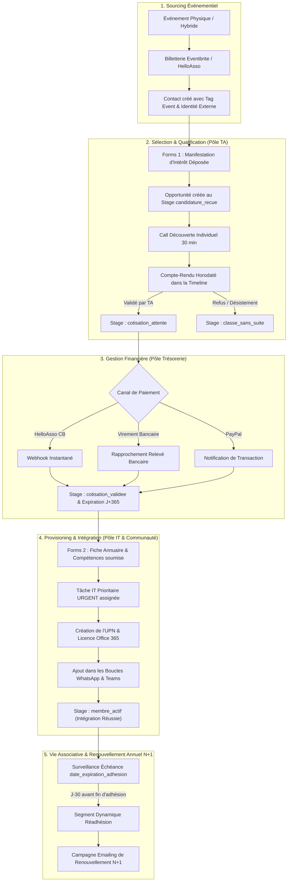

# Association Member Onboarding - Detailed Workflow & Architecture

> **Guide Opérationnel Détaillé & Cycle de Vie Associatif**  
> **Skill Associé** : [`association-member-onboarding`](SKILL.md)  
> **Exemples Concrets** : [`examples.md`](examples.md)  
> **Organisation de Référence** : Association *Diversité Alternative*

---

## 1. Vue d'Ensemble de l'Entonnoir Associatif Multi-Équipes

L'onboarding associatif relie 4 équipes opérationnelles (**Événements**, **Talent Acquisition**, **Trésorerie**, **IT & Communauté**) de façon coordonnée :



#### Équivalent Schéma ASCII :

```text
┌────────────────────────────────────────────────────────────────────────────────────────┐
│                   ENTONNOIR D'ONBOARDING ASSOCIATIF MULTI-ÉQUIPES                      │
├────────────────────────────────────────────────────────────────────────────────────────┤
│                                                                                        │
│  [ 1. SOURCING ÉVÉNEMENTIEL ]                                                          │
│    Événement (Physique/Hybride) ──► Billetterie (Eventbrite/HelloAsso) ──► Contact     │
│                                                                │   (Tag & Id Externe)  │
│                                                                ▼                       │
│  [ 2. SÉLECTION & QUALIFICATION (PÔLE TA) ]                                            │
│    Forms 1 (Candidature) ──► Opportunité (candidature_recue) ──► Call Découverte 30 min │
│                                                                │                       │
│                                                                ▼ (Validé par TA)       │
│  [ 3. GESTION FINANCIÈRE (PÔLE TRÉSORERIE) ]                                           │
│    Stage : cotisation_attente ──► Canal de Paiement (HelloAsso, Virement, PayPal)      │
│                                ──► Lettrage & Stage : cotisation_validee (J+365)       │
│                                                                │                       │
│                                                                ▼                       │
│  [ 4. PROVISIONING & INTÉGRATION (PÔLE IT & COMMUNAUTÉ) ]                              │
│    Forms 2 (Annuaire) ──► Tâche IT (URGENT) ──► Compte Microsoft 365 + Groupes WA      │
│                                              ──► Membre Actif 🎉 (100% Won)            │
│                                                                │                       │
│                                                                ▼                       │
│  [ 5. RÉTENTION & RÉADHÉSION N+1 ]                                                     │
│    Surveillance Expiration J-30 ──► Segment Dynamique ──► Campagne Réadhésion N+1     │
│                                                                                        │
└────────────────────────────────────────────────────────────────────────────────────────┘
```

---

## 2. Définition des Étapes du Pipeline `adhesion-membres`

| Stage ID | Nom Affiché | Probabilité | Action Obligatoire & Responsable |
|---|---|---|---|
| `event_attendee` | Participant Événement | 15 % | Envoi de la communication de remerciement et du lien Forms 1. |
| `candidature_recue` | Candidature Déposée (Forms 1) | 35 % | Revue du dossier par la TA et invitation au call via Calendly. |
| `call_decouverte` | Entretien Découverte Mené | 65 % | Entretien de 30 min, note de synthèse dans `crm.timeline`. |
| `cotisation_attente` | En Attente de Paiement | 80 % | Transmission des options de paiement (RIB, HelloAsso, PayPal). |
| `cotisation_validee` | Cotisation Encaissée | 90 % | Lettrage bancaire par la Tréso et envoi du Forms 2 Annuaire. |
| `onboarding_it` | Provisioning IT & Accès | 95 % | Création de l'UPN Microsoft 365 et ajout aux groupes WhatsApp. |
| `membre_actif` | Membre Confirmé (*Won*) | 100 % | Intégration opérationnelle dans le pôle d'action choisi. |
| `classe_sans_suite` | Désistement / Rejet (*Lost*) | 0 % | Archivage avec motif dans la timeline pour statistiques. |

---

## 3. Matrice des Champs Personnalisés de l'Annuaire (`CustomFields`)

```text
┌─────────────────────────────┬──────────────┬───────────────────────────────────────────┐
│ Clé Custom Field            │ Type         │ Rôle Opérationnel                         │
├─────────────────────────────┼──────────────┼───────────────────────────────────────────┤
│ statut_adhesion             │ CHOICE       │ candidat, adherent_actif, a_renouveler    │
│ canal_cotisation            │ CHOICE       │ helloasso_cb, virement_bancaire, paypal   │
│ montant_cotisation          │ INTEGER      │ Montant en euros (ex: 15, 30, 50)         │
│ date_adhesion               │ DATE         │ Date du paiement effectif                 │
│ date_expiration_adhesion    │ DATE         │ Date d'expiration (date_adhesion + 365j)  │
│ pole_principal              │ CHOICE       │ communication, evenements, partenariats   │
│ competences_cles            │ TEXT         │ Compétences pour l'annuaire associatif    │
│ linkedin_url                │ TEXT         │ Lien vers le profil professionnel         │
│ m365_upn                    │ TEXT         │ prenom.nom@diversite-alternative.org      │
│ m365_license_active         │ BOOLEAN      │ État de la licence Microsoft 365          │
│ whatsapp_joined             │ BOOLEAN      │ Confirmation d'ajout aux boucles WhatsApp │
└─────────────────────────────┴──────────────┴───────────────────────────────────────────┘
```
