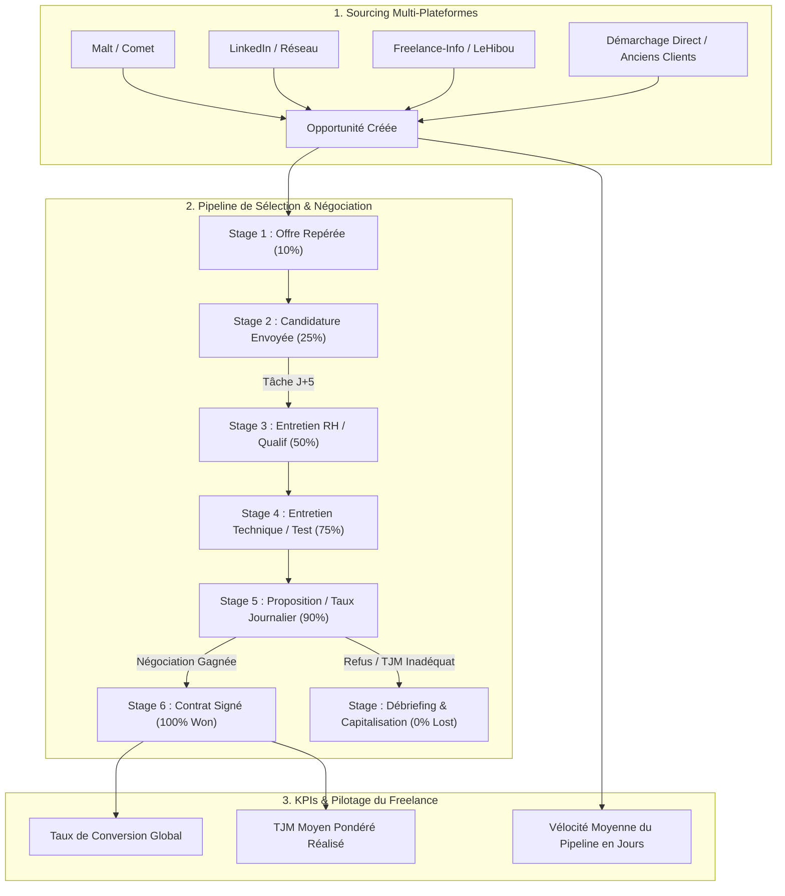

# Freelance Mission Hunter — Detailed Workflow & Architecture

> **Guide Opérationnel Détaillé & Entonnoir de Chasse Freelance**  
> **Skill Associé** : [`freelance-mission-hunter`](SKILL.md)  
> **Exemples Concrets** : [`examples.md`](examples.md)

---

## 1. Modélisation de l'Entonnoir de Prospection Freelance

La recherche de mission en période d'inter-contrat ou de transition s'opère selon un entonnoir rigoureux modélisé dans le pipeline `freelance-job-hunt` :



#### Équivalent Schéma ASCII :

```text
┌────────────────────────────────────────────────────────────────────────────────────────┐
│                   ENTONNOIR DE CHASSE DE MISSIONS FREELANCE & ATS                      │
├────────────────────────────────────────────────────────────────────────────────────────┤
│                                                                                        │
│  [ 1. SOURCING MULTI-PLATEFORMES ]                                                     │
│    • Malt / Comet ────────┐                                                            │
│    • LinkedIn / Réseau ───┼──► Opportunité créée (Client / ESN + TJM cible)            │
│    • Freelance-Info ──────┤                                                            │
│    • Démarchage Direct ───┘                                                            │
│                                                                │                       │
│                                                                ▼                       │
│  [ 2. PIPELINE DE SÉLECTION & NÉGOCIATION ]                                            │
│    Offre Repérée (10%) ──► Candidature Envoyée (25%) ──► Entretien RH (50%)            │
│                                    │ (Tâche Relance J+5)            │                  │
│                                    ▼                                ▼                  │
│    Débriefing / Refus (0%) ◄── Négociation TJM (90%) ◄── Entretien Tech / CTO (75%)    │
│            │                               │                                           │
│            ▼                               ▼                                           │
│    Capitalisation                Contrat Signé 🎉 (100% Won)                           │
│                                                                │                       │
│                                                                ▼                       │
│  [ 3. KPIS & ANALYTICS ]                                                               │
│    Taux de Conversion Global  •  TJM Moyen Pondéré  •  Vélocité Pipeline (Jours)       │
│                                                                                        │
└────────────────────────────────────────────────────────────────────────────────────────┘
```

---

## 2. Définition des Étapes (`Stages`) et Probabilités

| Stage ID | Nom de l'Étape | Probabilité | Déclencheur & Règle d'Action |
|---|---|---|---|
| `offre_reperee` | Offre Identifiée | 10 % | Sauvegarde de l'annonce, du client final et de l'intermédiaire éventuel (ESN). |
| `candidature_envoyee` | CV & Proposition Transmis | 25 % | Envoi personnalisé du pitch. **Génération obligatoire de la tâche de relance à J+5**. |
| `entretien_rh` | Screening RH / Découverte | 50 % | Call de 20 min avec le recruteur ou le responsable sourcing. Consignation dans la timeline. |
| `entretien_tech` | Validation Technique / CTO | 75 % | Entretien avec le Lead Dev / CTO ou test d'architecture. Préparation du mémo technique. |
| `proposition_tjm` | Négociation Tarif & Démarrage | 90 % | Accord de principe, arbitrage TJM, validation du contrat de prestation / bon de commande. |
| `contrat_signe` | Mission Décrochée (*Won*) | 100 % | Signature électronique du contrat, démarrage calé, mise à jour du CA prévisionnel. |
| `refus_debriefing` | Débriefing & Capitalisation (*Lost*) | 0 % | Note détaillée des motifs de refus (TJM trop élevé, profil senior vs lead, etc.). |

---

## 3. Formule de Calcul du CA Prévisionnel Pondéré

Chaque opportunité possède une valeur financière calculée automatiquement :

$$\text{Valeur HT} = \text{TJM} \times \text{Nombre de Jours Ouvrés Estimés}$$
$$\text{Revenu Pondéré} = \text{Valeur HT} \times \text{Probabilité du Stage}$$

*Exemple* :  
Une mission de 6 mois (120 jours) à 650 €/jour représente **78 000 € HT**.  
Au stage `entretien_tech` (75 %), elle contribue au prévisionnel à hauteur de :  
$$78\,000 \times 0.75 = 58\,500\text{ \texteuro}$$
