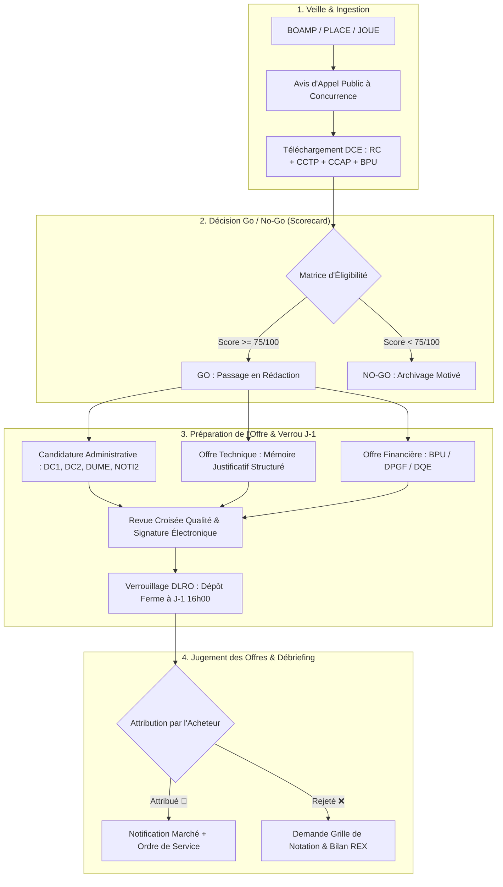

# Public Tender Qualifier — Detailed Workflow & Architecture

> **Guide Opérationnel Détaillé & Commande Publique**  
> **Skill Associé** : [`public-tender-qualifier`](file:///Users/awf/workspace/professionnal/webtech/packages/pycrmkit/.agents/skills/public-tender-qualifier/SKILL.md)  
> **Exemples Concrets** : [`examples.md`](file:///Users/awf/workspace/professionnal/webtech/packages/pycrmkit/.agents/skills/public-tender-qualifier/examples.md)

---

## 1. Cycle de Vie d'une Réponse à Marché Public

La commande publique impose un formalisme strict régi par le Code de la Commande Publique :

---

## 2. Définition des Étapes du Pipeline `public-tenders-bid-management`

| Stage ID | Nom de l'Étape | Probabilité | Exigence Métier |
|---|---|---|---|
| `veille_dce` | DCE Téléchargé & Veille | 10 % | Analyse du Règlement de Consultation (RC) et du CCTP. |
| `go_decision` | Qualification Go / No-Go | 30 % | Validation formelle par le chef d'entreprise / directeur de pôle. |
| `redaction_reponse` | Rédaction Mémoire & Prix | 60 % | Rédaction du mémoire technique, constitution du GME si cotraitance. |
| `depot_effectue` | Pli Déposé sur Plateforme | 85 % | Récépissé horodaté téléchargé depuis PLACE/AWS/Maximilien. |
| `audition_orale` | Soutenance / Négociation | 90 % | Présentation devant la commission d'appel d'offres (si prévue au RC). |
| `marche_attribue` | Marché Notifié (*Won*) | 100 % | Réception de la lettre d'attribution et de l'acte d'engagement signé. |
| `offre_rejetee` | Rejet & Débriefing (*Lost*) | 0 % | Capitalisation des notes techniques/prix pour les futurs dossiers. |

---

## 3. Matrice de Décision Go / No-Go (Scorecard /100)

| Critère d'Évaluation | Poids | Condition d'Élimination Directe (*Red Flag*) |
|---|---|---|
| **Adéquation Technique (CCTP)** | 35 pts | Si moins de 85% des livrables maîtrisés sans sous-traitance $\rightarrow$ **NO-GO**. |
| **Pondération des Critères** | 25 pts | Si le Prix représente plus de 70% de la note finale $\rightarrow$ **NO-GO** (guerre des prix). |
| **Calendrier & Disponibilité** | 20 pts | Si la DLRO est inférieure à 10 jours ouvrés sans équipe mobilisée $\rightarrow$ **NO-GO**. |
| **Rentabilité & Marge Cible** | 20 pts | Si la marge brute estimée est inférieure à 25 % $\rightarrow$ **NO-GO**. |

> **Règle absolue** : Seul un score $\ge 75/100$ sans aucun *Red Flag* permet de passer au stage `redaction_reponse`.
