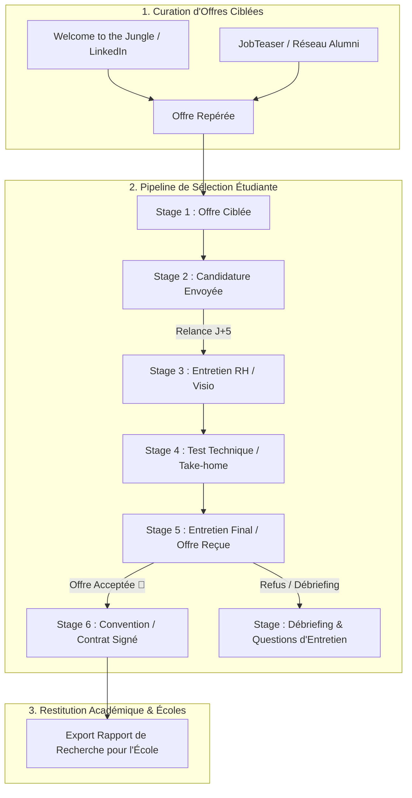

# Student Career Launch — Detailed Workflow & Architecture

> **Guide Opérationnel Détaillé & ATS Étudiant / Alternance**  
> **Skill Associé** : [`student-career-launch`](file:///Users/awf/workspace/professionnal/webtech/packages/pycrmkit/.agents/skills/student-career-launch/SKILL.md)  
> **Exemples Concrets** : [`examples.md`](file:///Users/awf/workspace/professionnal/webtech/packages/pycrmkit/.agents/skills/student-career-launch/examples.md)

---

## 1. Cycle de Candidature Étudiant & Insertion Professionnelle

Le pipeline `student-career-launch` structure les démarches pour décrocher un stage, une alternance ou un premier emploi en évitant le piège de la passivité :

---

## 2. Définition des Étapes du Pipeline `student-career-launch`

| Stage ID | Nom Affiché | Probabilité | Déclencheur & Action |
|---|---|---|---|
| `offre_ciblee` | Offre Sélectionnée | 10 % | Analyse des prérequis techniques et de la localisation. |
| `candidature_envoyee` | CV & Lettre Transmis | 25 % | Envoi de la candidature. **Tâche de relance courtoise fixée à J+5**. |
| `entretien_rh` | Entretien RH / Découverte | 50 % | Échange de 20-30 min. Préparation de la fiche entreprise sous les yeux. |
| `test_technique` | Test Technique / Kata | 70 % | Réalisation du kata de code ou QCM d'algorithmique. |
| `entretien_manager` | Entretien Final / CTO | 85 % | Échange d'adéquation technique et humaine avec l'équipe. |
| `offre_acceptee` | Offre Signée (*Won*) | 100 % | Signature de la convention de stage ou du contrat d'apprentissage CERFA. |
| `candidature_classee` | Rejet / Désistement (*Lost*) | 0 % | Capitalisation des questions posées et axes d'amélioration. |

---

## 3. Stratégie de Relance Courtoise à J+5

Un recruteur RH ou campus manager reçoit des centaines de candidatures. Une relance bienveillante, courtoise et personnalisée à J+5 permet de se démarquer immédiatement :

### Modèle de message de relance :
> *« Bonjour [Prénom Recruteur], je me permets de vous contacter suite à ma candidature déposée le [Date] pour le poste d'[Intitulé]. Très motivé(e) par vos réalisations récentes sur [Projet de l'entreprise], je souhaitais m'assurer de la bonne réception de mon dossier et me tiens à votre entière disposition pour un échange. Bien cordialement, [Votre Nom] »*
