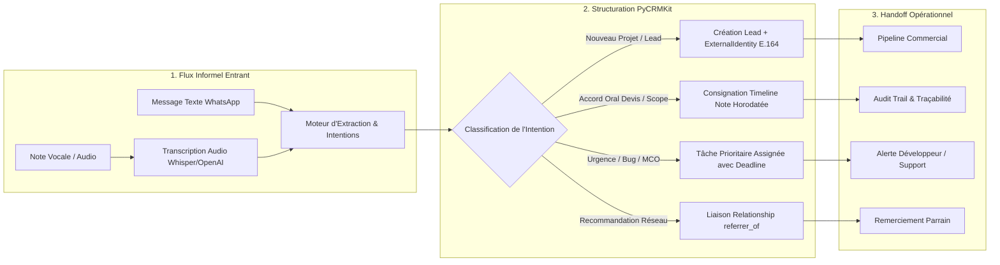

# WhatsApp Dialog Processor — Detailed Workflow & Architecture

> **Guide Opérationnel Détaillé & Transformation Conversationnelle**  
> **Skill Associé** : [`whatsapp-dialog-processor`](SKILL.md)  
> **Exemples Concrets** : [`examples.md`](examples.md)

---

## 1. Philosophie : Du Flux Informel au Modèle Relationnel

WhatsApp est le canal n°1 de la confiance relationnelle en Afrique francophone, en Europe du Sud et dans les milieux associatifs. Cependant, c'est aussi le principal cimetière d'accords verbaux, de devis perdus et de demandes urgentes non traitées.

Le rôle du processeur WhatsApp est de **cristalliser l'informel en données opposables** dans PyCRMKit :



#### Équivalent Schéma ASCII :

```text
┌────────────────────────────────────────────────────────────────────────────────────────┐
│                   DU FLUX INFORMEL WHATSAPP AU MODÈLE RELATIONNEL                      │
├────────────────────────────────────────────────────────────────────────────────────────┤
│                                                                                        │
│  [ 1. FLUX INFORMEL ENTRANT ]                                                          │
│    • Message Texte WhatsApp ──┐                                                        │
│    • Note Vocale / Audio   ──► Transcription STT ──► Moteur d'Extraction               │
│                                                              │                         │
│                                                              ▼                         │
│  [ 2. STRUCTURATION PYCRMKIT ]                                                         │
│    Moteur d'Extraction ──► Classification d'Intention :                                │
│                             ├── Nouveau Projet ──► Création Lead + E.164 Externe       │
│                             ├── Accord Oral    ──► Note Horodatée dans la Timeline     │
│                             ├── Bug / Urgence  ──► Tâche Priorité URGENT + Échéance    │
│                             └── Recommandation ──► Liaison Relationship (Parrain)      │
│                                                              │                         │
│                                                              ▼                         │
│  [ 3. HANDOFF OPÉRATIONNEL ]                                                           │
│    Pipeline Commercial  ◄── Audit Trail  ◄── Alerte Support  ◄── Remerciement Parrain   │
│                                                                                        │
└────────────────────────────────────────────────────────────────────────────────────────┘
```

---

## 2. Grille de Détection des Intentions

Lorsqu'un message ou vocal WhatsApp est transcrit, appliquer la matrice de décision suivante :

| Détecteurs Clés dans le Message | Intention Métier | Action Automatique dans PyCRMKit | Entités Cibles |
|---|---|---|---|
| *« Salut, j'ai un projet pour toi... »*, *« Tu as un créneau pour une refonte ? »* | **Nouveau Lead / Opportunité** | Création d'un `Lead` sourcé `whatsapp_direct`, rattachement de l'E.164. | `Lead`, `ExternalIdentity` |
| *« C'est bon pour moi, on lance le devis »*, *« Validé pour le budget discuté »* | **Accord Oral Ferme** | Transition de stage vers `won`, consigne horodatée avec extrait exact. | `StageTransition`, `TimelineEntry` |
| *« Le site est en carafe »*, *« Les paiements ne passent plus »*, *« Urgent bug »* | **Incident Critique MCO** | Création d'une `Task` de priorité `URGENT` liée au client. | `Task` (Priority URGENT) |
| *« Je t'écris de la part de Sophie... »*, *« C'est Karim qui m'a donné ton contact »* | **Recommandation Réseau** | Recherche de l'apporteur d'affaires et création d'une `Relationship`. | `Relationship` (`referred_by`) |

---

## 3. Gestion de l'Identité Externe E.164

Pour garantir qu'un même numéro ne crée pas de doublons lors de futurs échanges, le numéro doit impérativement être normalisé au format **E.164** (ex: `+33612345678` ou `+237699112233`) :

- `ExternalIdentity.provider = "whatsapp"`
- `ExternalIdentity.external_id = "<E.164_PHONE>"`
- Métadonnées optionnelles : `wa_group_name`, `last_interaction_at`.
