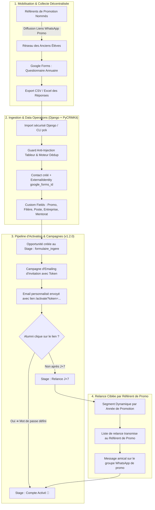

# Analyse Approfondie : Création d'un Annuaire d'Alumni, Référents de Promo & Activation Django avec PyCRMKit

> **Document de Référence Méthodologique & Réseaux d'Anciens Élèves**  
> **Auteur** : Thomas Awounfouet / WebTech Forge  
> **Cas d'Usage** : Association d'Alumni & Écoles d'Ingénieurs / Universités (ex: Réseau Prépa Vogt Alumni, Écoles d'Ingénieurs)  
> **Plateforme Hôte** : Application Django + Module PyCRMKit  
> **Version PyCRMKit** : >= 1.2.0  
> **Statut** : Validé pour implémentation

---

## 1. Contexte & Enjeux : Pourquoi les Annuaires d'Alumni Échouent Souvent

La force d'un réseau d'anciens élèves (écoles d'ingénieurs, universités, instituts) réside dans son **annuaire professionnel**. Pourtant, la majorité des projets d'annuaires subissent un échec opérationnel précoce :

```text
┌────────────────────────────────────────────────────────────────────────────────────────┐
│                        LE CERCLE VICIEUX DES ANNUAIRES D'ALUMNI                        │
├────────────────────────────────────────────────────────────────────────────────────────┤
│                                                                                        │
│   1. Collecte naïve par Google Forms                                                   │
│      (Réponses dispersées, doublons, emails obsolètes, fautes de frappe)                │
│                                │                                                       │
│                                ▼                                                       │
│   2. Import brut par script Django (`User.objects.create`)                             │
│      (Aucune déduplication, absence de traçabilité, données corrompues)               │
│                                │                                                       │
│                                ▼                                                       │
│   3. Envoi massif d'invitations sans suivi d'état                                      │
│      (25% des emails rebondissent, 50% ne cliquent jamais sur le lien)                 │
│                                │                                                       │
│                                ▼                                                       │
│   4. Annuaire fantôme (Taux d'activation < 20%)                                        │
│      (Les alumnis ne se connectent pas, le réseau s'éteint, démotivation générale)    │
│                                                                                        │
└────────────────────────────────────────────────────────────────────────────────────────┘
```

### Les 4 Piliers de la Réussite d'un Annuaire :
1. **La Collecte Décentralisée par Promotion** : S'appuyer sur des *Référents de promo* (ambassadeurs) pour diffuser le formulaire sur les groupes WhatsApp de promotion plutôt qu'un appel froid par email.
2. **Le Nettoyage & la Déduplication (Data Operations)** : Protéger la base contre les injections tableur (`=CMD`, `+SUM`) et fusionner les réponses en double.
3. **Le Pipeline d'Activation des Comptes** : Traiter chaque alumni comme une opportunité d'onboarding avec des étapes claires : `Formulaire Rempli ➔ Fiche Qualifiée ➔ Invitation Envoyée ➔ Compte Activé 🎉`.
4. **L'Animation par les Référents de Promo** : Fournir à chaque référent la liste exacte de ses camarades de promo n'ayant pas encore activé leur compte pour une relance bienveillante en un clic.

---

## 2. Cartographie Globale du Flux de Valeur (Mermaid + ASCII)



#### Équivalent Schéma ASCII :
```text
┌────────────────────────────────────────────────────────────────────────────────────────┐
│                   CYCLE COMPLET DE CRÉATION & ACTIVATION DE L'ANNUAIRE                 │
├────────────────────────────────────────────────────────────────────────────────────────┤
│                                                                                        │
│  [ RÉFÉRENTS DE PROMO ] ──► Partagent le Google Forms sur les groupes WhatsApp de promo│
│             │                                                                          │
│             ▼                                                                          │
│  [ RÉPONSES GOOGLE FORMS ] ──► Export CSV / Excel nettoyé                              │
│             │                                                                          │
│             ▼                                                                          │
│  [ INGESTION DATAOPS ] ──► Protection Anti-Injection + Moteur de Déduplication         │
│             │                                                                          │
│             ▼                                                                          │
│  [ CRÉATION CONTACTS ] ──► Tags promo (#promo-2020) + Champs Annuaire (Poste, Entrepr) │
│             │                                                                          │
│             ▼                                                                          │
│  [ CAMPAGNE INVITATION ] ──► Envoi d'email avec lien d'activation unique              │
│             │                                                                          │
│             ├──► Clic & Mot de passe ──► [ COMPTE DJANGO ACTIVÉ 🎉 ] ──► Accès Annuaire│
│             │                                                                          │
│             └──► Non activé à J+7 ──► [ RELANCE RÉFÉRENT WHATSAPP ] ──► Finalisation   │
│                                                                                        │
└────────────────────────────────────────────────────────────────────────────────────────┘
```

---

## 3. Implémentation du Pipeline d'Activation dans PyCRMKit

Le pipeline d'onboarding est identifié sous le nom `alumni-directory-activation` :

| Étape (`Stage`) | Nom Affiché | Probabilité | Action Obligatoire & Responsable |
|---|---|---|---|
| `formulaire_ingere` | Formulaire Rempli | 20 % | Données Google Forms importées et parsées dans PyCRMKit. |
| `fiche_qualifiee` | Données Dédupliquées | 40 % | Validation anti-doublon et normalisation de l'email et du téléphone. |
| `invitation_envoyee` | Invitation Transmise | 60 % | Expédition de l'email d'invitation avec jeton temporaire unique. |
| `relance_j7` | Relance Nécessaire (J+7) | 50 % | Jeton non consommé après 7 jours $\rightarrow$ alerte au référent de promo. |
| `compte_active` | Compte Activé (*Won*) | 100 % | L'alumni a validé son mot de passe et accède à l'annuaire complet. |
| `email_rebond` | Email Invalide (*Lost*) | 0 % | Rebond SMTP (bounce) $\rightarrow$ vérification du numéro mobile sur WhatsApp. |

---

## 4. Modélisation de Données & Intégration Native Django

Grâce à l'architecture modulaire de PyCRMKit, le CRM s'exécute directement dans le runtime Django sans base de données tierce.

### A. Modèle Contact & Double Identité (`ExternalIdentity`)
```python
from pycrmkit import CRM
from pycrmkit.contacts import ContactEmail, ContactPhone
from pycrmkit.external_identities import ExternalIdentity

crm = CRM.memory()  # ou DjangoUnitOfWork dans une application Django

# 1. Création de la fiche de l'alumni
alumni = crm.contacts.create(
    first_name="Christian",
    last_name="Mvondo",
    emails=(
        ContactEmail("christian.mvondo@gmail.com", is_primary=True),
        ContactEmail("c.mvondo@totalenergies.com", is_primary=False),
    ),
    phones=(ContactPhone("+33612345678", is_primary=True),),
    source="google_forms_promo_2019",
)

# 2. Liaison de l'ID de réponse Google Forms et du futur User Django
crm.external_identities.link(
    entity_kind="contact",
    entity_id=alumni.id,
    identity=ExternalIdentity(provider="google_forms", external_id="response_row_842"),
)
```

### B. Champs Spécifiques de l'Annuaire (`CustomFields`)
```python
from pycrmkit.custom_fields import CustomFieldDefinition, CustomFieldType

champs_annuaire = [
    CustomFieldDefinition(key="annee_promo", name="Année de Promotion", field_type=CustomFieldType.INTEGER),
    CustomFieldDefinition(key="filiere_etude", name="Filière / Spécialité", field_type=CustomFieldType.TEXT),
    CustomFieldDefinition(key="poste_actuel", name="Intitulé du Poste", field_type=CustomFieldType.TEXT),
    CustomFieldDefinition(key="entreprise_actuelle", name="Entreprise / Employeur", field_type=CustomFieldType.TEXT),
    CustomFieldDefinition(key="pays_residence", name="Pays de Résidence", field_type=CustomFieldType.TEXT),
    CustomFieldDefinition(key="ville_residence", name="Ville de Résidence", field_type=CustomFieldType.TEXT),
    CustomFieldDefinition(key="profil_linkedin", name="URL Profil LinkedIn", field_type=CustomFieldType.TEXT),
    CustomFieldDefinition(key="ouvert_au_mentorat", name="Prêt à Mentorer un Étudiant", field_type=CustomFieldType.BOOLEAN),
    CustomFieldDefinition(
        key="statut_activation",
        name="Statut d'Activation Compte",
        field_type=CustomFieldType.CHOICE,
        choices=("non_invite", "invitation_envoyee", "compte_active", "relance_requise"),
    ),
]
```

### C. Relation Référent de Promo $\leftrightarrow$ Membres (`Relationships`)
```python
from pycrmkit.core.references import EntityReference

# Le référent de la promo 2019 parraine et anime les membres de sa cohorte
referent_ref = EntityReference("contact", "contact_referent_2019")
alumni_ref = EntityReference("contact", alumni.id)

crm.relationships.create(
    source=referent_ref,
    relationship_type="ambassador_of",
    target=alumni_ref,
)
```

---

## 5. Ingestion Sécurisée & Déduplication Anti-Injection Tableur

Lorsque le fichier Google Forms (CSV/Excel) est uploadé dans Django :
1. **Protection Anti-Injection CSV** : Les chaînes commençant par `=`, `+`, `-`, ou `@` sont automatiquement échappées (`'=CMD|...`) pour éviter l'exécution de code malveillant sur les postes de l'équipe alumni.
2. **Algorithme de Déduplication** :
   - Comparaison sur l'email normalisé (`lower()`).
   - Comparaison floue sur `nom` + `prénom` + `annee_promo`.
   - Si un doublon est détecté avec un score $\ge 85$ : enrichissement de la fiche existante au lieu de créer un doublon.

---

## 6. Pilotage & Tableau de Bord Exécutif pour le Réseau Alumni

En ouvrant la console de pilotage :
```bash
pck dashboard
```

```text
╭──────────────────────────────────────────────────────────────────────────────╮
│  🎓 Réseau Alumni & Annuaire Professionnel  •  Mode: Django / PostgreSQL     │
│  Télémétrie d'Onboarding & Taux d'Activation par Promotion                   │
╰──────────────────────────────────────────────────────────────────────────────╯
╭─── 👥 Fiches Collectées ──╮ ╭───── 🔑 Comptes Activés ─────╮ ╭── 🎯 Taux Global ───╮
│ 450 Réponses Google Forms │ │ 368 Membres Actifs (Won)     │ │ 81.7 % d'Activation │
│ Couverture : 12 Promos    │ │ Accès Annuaire Délivré       │ │ Objectif : > 80 %   │
╰───────────────────────────╯ ╰──────────────────────────────╯ ╰─────────────────────╯

                   Taux d'Activation par Promotion (Ambassadeurs)
┏━━━━━━━━━━━━━━━┳━━━━━━━━━━━━━━━━━━┳━━━━━━━━━━━━━━━━━━┳━━━━━━━━━━━━━━━━━━━━━━━━┓
┃ Promotion     ┃ Réponses Forms   ┃ Comptes Activés  ┃ Taux d'Activation      ┃
┡━━━━━━━━━━━━━━━╇━━━━━━━━━━━━━━━━━━╇━━━━━━━━━━━━━━━━━━╇━━━━━━━━━━━━━━━━━━━━━━━━┩
│ Promo 2018    │        45        │        42        │ 93.3 % (Excellente !)  │
│ Promo 2019    │        52        │        48        │ 92.3 % (Excellente !)  │
│ Promo 2020    │        60        │        49        │ 81.6 % (Conforme)      │
│ Promo 2021    │        48        │        34        │ 70.8 % (Relance J+7)   │
│ Promo 2022    │        55        │        32        │ 58.1 % (Alerte Référent│
└───────────────┴──────────────────┴──────────────────┴────────────────────────┘
```

---

## 7. Synthèse : Valeur Ajoutée de PyCRMKit

| Défi de l'Annuaire Alumni | Solution Traditionnelle (Script Bête) | Avec PyCRMKit dans Django |
|---|---|---|
| **Qualité des Réponses Forms** | Import aveugle, doublons massifs | **Déduplication déterministe et fusion de contacts** |
| **Sécurité des Fichiers CSV** | Risque d'injection formules | **Nettoyage anti-formule tableur natif** |
| **Suivi des Invitations** | Booléen `is_active` sans historique | **Historique d'envoi et de clics dans la Timeline** |
| **Mobilisation des Référents** | Listes manuelles partagées sur WhatsApp | **Segments dynamiques par promo en 1 commande** |
| **Évolution vers les Cotisations**| Nouveau projet complexe à redévelopper | **Transition fluide vers les cotisations d'alumni** |
