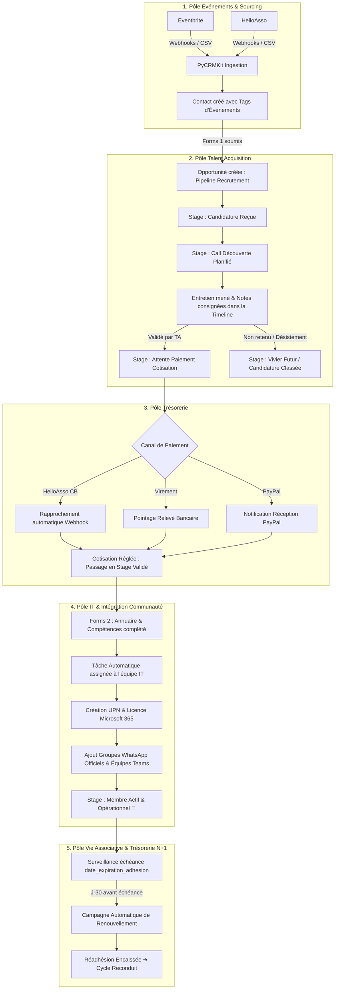

# Analyse Approfondie : Cycle de Vie Adhérents, Onboarding & Rétention Associative avec PyCRMKit

> **Document de Référence Méthodologique & Transformation Associative**  
> **Auteur** : Thomas Awounfouet / WebTech Forge  
> **Cas d'Usage** : Association *Diversité Alternative*  
> **Cible** : Bureaux d'associations, Pôles Talent Acquisition (TA), Trésorerie, Équipes IT & Responsables Communauté  
> **Version PyCRMKit** : >= 1.2.0  
> **Statut** : Validé pour mise en œuvre opérationnelle

---

## 1. Contexte : Le Défi Opérationnel de l'Association « Diversité Alternative »

L'association **Diversité Alternative** déploie une dynamique forte au service de l'inclusion et de l'égalité des chances. Son modèle repose sur :
- **2 à 4 grands événements physiques ou hybrides par an** (conférences, ateliers, galas, afterworks networking).
- **Une billetterie obligatoire** via **Eventbrite** et/ou **HelloAsso** pour maîtriser les jauges et capter les participants.
- **Un fort intérêt suscité lors de ces rencontres** : plusieurs dizaines de participants manifestent le souhait de s'engager activement et d'intégrer l'association à l'issue de chaque événement.

### Le Parcours Public affiché sur le Site Web :
L'association communique auprès du public sur un parcours transparent en 4 étapes :

```
┌────────────────────────────────────────────────────────────────────────────────────────┐
│                      LE PARCOURS D'ENGAGEMENT EN 4 ÉTAPES (SITE WEB)                    │
├───────────────────┬───────────────────┬────────────────────────┬───────────────────────┤
│   1. Découverte   │ 2. Formulaire de  │ 3. Call de Découverte  │     4. Adhésion       │
│                   │      Contact      │                        │                       │
│ Participez à nos  │ Remplissez notre  │ Échange individuel     │ Rejoignez             │
│ événements et     │ formulaire en     │ avec un membre de      │ officiellement        │
│ découvrez notre   │ ligne pour        │ l'équipe Talent        │ l'association et son  │
│ mission.          │ postuler.         │ Acquisition.           │ équipe active.        │
└───────────────────┴───────────────────┴────────────────────────┴───────────────────────┘
```

---

## 2. La Réalité Interne : L'Enfer des Silos d'Outils et de la Dispersion

Derrière cette vitrine limpide, les équipes internes de l'association (**Talent Acquisition**, **Trésorerie**, **IT & Administration M365**, **Responsables Communauté**) subissent un enchaînement d'outils hétérogènes non connectés :

```text
┌────────────────────────────────────────────────────────────────────────────────────────┐
│                       LA FRAGMENTATION ACTUELLE DES DONNÉES                            │
├─────────────────────────┬──────────────────────────────────┬───────────────────────────┤
│ Source / Étape          │ Outil utilisé                    │ Problème rencontré        │
├─────────────────────────┼──────────────────────────────────┼───────────────────────────┤
│ Inscription Événement   │ Eventbrite / HelloAsso           │ Fichier CSV isolé         │
│ Candidature             │ Microsoft Forms (Forms 1)        │ Tableur Excel TA séparé   │
│ Entretien individuel    │ Calendly / WhatsApp / Bloc-notes │ Notes de call éparpillées │
│ Règlement Cotisation    │ Virement bancaire / HelloAsso /  │ Rapprochement manuel très │
│                         │ PayPal (3 canaux concurrents !)  │ lourd en trésorerie       │
│ Renseignements Annuaire │ Microsoft Forms (Forms 2)        │ Données privées dispersées│
│ Provisioning IT         │ Console Admin Microsoft 365      │ Saisie manuelle de l'UPN  │
│ Intégration Communauté  │ Groupes WhatsApp & Canaux Teams  │ Oublis fréquents d'ajouts │
│ Renouvellement Annuel   │ Relevés bancaires                │ Relances artisanales à N+1│
└─────────────────────────┴──────────────────────────────────┴───────────────────────────┘
```

### Les 5 pathologies organisationnelles constatées :
1. **La déperdition de candidats motivés** : Entre l'événement et le call de découverte, jusqu'à 40 % des profils qualifiés sont perdus faute d'un pipeline de suivi réactif et d'alertes automatiques.
2. **Le casse-tête du lettrage financier multi-canal** : La Trésorerie doit pointer manuellement des virements anonymes (*« VIRT ADH 2026 »* sans nom précis) face aux paiements CB HelloAsso et aux réceptions PayPal.
3. **Le double fardeau des formulaires Microsoft Forms** : Avoir deux formulaires distincts (candidature initiale courte, puis questionnaire annuaire détaillé post-paiement) génère des ruptures de traçabilité.
4. **Le risque de sécurité IT (Comptes orphelins)** : L'IT n'étant pas toujours notifiée des départs ou des baisses d'implication, des comptes Microsoft 365 restent actifs inutilement, gaspillant des licences et créant des failles de conformité RGPD.
5. **L'érosion des cotisations annuelles** : Aucun système automatisé ne prévient la Trésorerie qu'un adhérent arrive à son échéance des 365 jours.

---

## 3. Cartographie Globale du Flux de Valeur dans PyCRMKit

PyCRMKit unifie l'ensemble des acteurs au sein d'une **source unique de vérité**, reliant les flux d'inscriptions, le pipeline de recrutement, le paiement des cotisations, le provisioning IT et le suivi de la vie associative.



#### Équivalent Schéma ASCII :
```text
┌─────────────────────────────────────────────────────────────────────────────────────────────────┐
│                                 FLUX DE VALEUR PYCRMKIT DE BOUT EN BOUT                         │
├─────────────────────────────────────────────────────────────────────────────────────────────────┤
│                                                                                                 │
│  [ EVENTBRITE / HELLOASSO ] ──► Ingestion & Agrégation Contact (#event-q1-2026)                │
│             │                                                                                   │
│             ▼                                                                                   │
│  [ FORMULAIRE CONTACT (Forms 1) ] ──► Déclenche Opportunité d'Adhésion                          │
│             │                                                                                   │
│             ▼                                                                                   │
│  [ TEAM TALENT ACQUISITION ] ──► Entretien individuel (Timeline & Synthèse de Call)             │
│             │                                                                                   │
│             ▼                                                                                   │
│  [ PAIEMENT MULTI-CANAL ] ──► Lettrage Trésorerie (HelloAsso / Virement / PayPal)               │
│             │                                                                                   │
│             ▼                                                                                   │
│  [ FORMULAIRE ANNUAIRE (Forms 2) ] ──► Enrichissement Custom Fields & Compétences              │
│             │                                                                                   │
│             ▼                                                                                   │
│  [ TEAM IT & ADMIN M365 ] ──► Provisioning du compte M365 (prenom.nom@asso.org)                │
│             │                                                                                   │
│             ▼                                                                                   │
│  [ ONBOARDING COMMUNAUTÉ ] ──► Boucles WhatsApp (Général + Pôle) & Canaux Teams                │
│             │                                                                                   │
│             ▼                                                                                   │
│  [ VIE ASSOCIATIVE & TRÉSO N+1 ] ──► Surveillance J-30 & Campagne de Réadhésion                 │
│                                                                                                 │
└─────────────────────────────────────────────────────────────────────────────────────────────────┘
```

---

## 4. Configuration du Pipeline Associatif dans PyCRMKit

Le pipeline commercial de PyCRMKit est configuré sous l'identifiant `adhesion-membres` avec des étapes, des probabilités et des critères de passage stricts :

| Étape (`Stage`) | Nom Affiché | Probabilité | Rôle Responsable | Action Attendue |
|---|---|---|---|---|
| `event_attendee` | Participation Événement | 15 % | Événements | Envoi du lien vers le Formulaire 1 de manifestation d'intérêt. |
| `candidature_recue` | Candidature Déposée | 35 % | Talent Acquisition | Revue de profil et planification du call de découverte via Calendly. |
| `call_decouverte` | Entretien Individuel | 65 % | Talent Acquisition | Entretien de 30 min, évaluation de l'adéquation mission/valeurs. |
| `cotisation_attente` | En Attente de Paiement | 80 % | Trésorerie & Candidat | Envoi des options de règlement (HelloAsso, RIB asso, PayPal). |
| `cotisation_validee` | Cotisation Encaissée | 90 % | Trésorerie | Validation bancaire, émission du reçu et transmission du Forms 2. |
| `onboarding_it` | Provisioning IT & Accès | 95 % | Team IT & Admin M365 | Création du compte M365, génération mot de passe, ajout Teams/WhatsApp. |
| `membre_actif` | Adhérent Confirmé (*Won*) | 100 % | Bureau & Pôle | Attribution d'un parrain/marraine et intégration aux projets. |
| `classe_sans_suite` | Désistement / Rejet (*Lost*) | 0 % | Talent Acquisition | Archivage courtois avec tag `#vivier-futur` pour invitation aux events. |

---

## 5. Modélisation Précise des Données (Python & PyCRMKit Core)

### A. Entité Contact & Multi-Identités (`ExternalIdentity`)
Chaque personne possède une fiche unique qui consolide l'ensemble de ses canaux :

```python
from pycrmkit import CRM
from pycrmkit.contacts import ContactEmail, ContactPhone
from pycrmkit.core.references import EntityReference
from pycrmkit.external_identities import ExternalIdentity

crm = CRM.memory()  # ou persistance PostgreSQL locale pycrm

# 1. Création de la fiche d'un participant issu d'un événement
contact = crm.contacts.create(
    first_name="Khadija",
    last_name="Benali",
    emails=(ContactEmail("khadija.benali.perso@gmail.com", is_primary=True),),
    phones=(ContactPhone("+33698765432", is_primary=True),),
    source="eventbrite_gala_annuel",
)

# 2. Rattachement de l'identifiant de billet Eventbrite
crm.external_identities.link(
    entity_kind="contact",
    entity_id=contact.id,
    identity=ExternalIdentity(
        provider="eventbrite",
        external_id="eb_ticket_99182374",
    ),
)
```

### B. Champs Personnalisés indispensables (`CustomFields`)

```python
from pycrmkit.custom_fields import CustomFieldDefinition, CustomFieldType

champs_associatifs = [
    # Suivi Financier & Adhésion
    CustomFieldDefinition(
        key="statut_adhesion",
        name="Statut Adhésion",
        field_type=CustomFieldType.CHOICE,
        choices=("candidat", "adherent_actif", "a_renouveler", "alumnus"),
    ),
    CustomFieldDefinition(
        key="canal_cotisation",
        name="Canal de Cotisation",
        field_type=CustomFieldType.CHOICE,
        choices=("helloasso_cb", "virement_bancaire", "paypal", "especes"),
    ),
    CustomFieldDefinition(
        key="montant_cotisation",
        name="Montant Cotisation Réglée",
        field_type=CustomFieldType.INTEGER,  # ex: 15, 30, 50 euros
    ),
    CustomFieldDefinition(
        key="date_expiration_adhesion",
        name="Date Fin Validité Cotisation",
        field_type=CustomFieldType.DATE,
    ),
    # Affectation & Compétences (Forms 2)
    CustomFieldDefinition(
        key="pole_principal",
        name="Pôle d'Affectation",
        field_type=CustomFieldType.CHOICE,
        choices=("communication", "evenementiel", "partenariats", "ta", "it", "tresorerie"),
    ),
    CustomFieldDefinition(
        key="competences_cles",
        name="Compétences Spécifiques",
        field_type=CustomFieldType.TEXT,  # ex: "Design Figma, Montage Vidéo, Droit associatif"
    ),
    CustomFieldDefinition(
        key="linkedin_url",
        name="Profil LinkedIn",
        field_type=CustomFieldType.TEXT,
    ),
    # Provisioning & Communauté
    CustomFieldDefinition(
        key="m365_upn",
        name="Compte Email Microsoft 365",
        field_type=CustomFieldType.TEXT,  # ex: khadija.benali@diversite-alternative.org
    ),
    CustomFieldDefinition(
        key="m365_license_active",
        name="Licence M365 Active",
        field_type=CustomFieldType.BOOLEAN,
    ),
    CustomFieldDefinition(
        key="whatsapp_joined",
        name="Intégré aux Groupes WhatsApp",
        field_type=CustomFieldType.BOOLEAN,
    ),
]
```

---

## 6. Le Rôle et l'Expérience Utilisateur par Équipe

### 🎯 Pôle 1 : Talent Acquisition (TA)
- **Réception centralisée** : Toute soumission du *Forms 1* crée immédiatement une opportunité dans `pck` au stage `candidature_recue`.
- **Historique chronologique (`Timeline`)** :
  - L'entretien de 30 minutes fait l'objet d'un compte-rendu consigné directement dans la timeline du contact :
    ```python
    crm.timeline.record_meeting(
        contact_id=contact.id,
        title="Entretien Découverte TA avec Khadija",
        description="Forte motivation pour le pôle Événementiel. Expérience passée en gestion de salons. Validée !",
        actor_id="recruteur-ta-thomas",
    )
    ```
- **Clarté du pipeline** : En tapant `pck sales opps`, la team TA visualise instantanément tous les entretiens à planifier et les dossiers en attente.

### 💰 Pôle 2 : Trésorerie & Cotisations
- **Unification du multi-canal** :
  - **HelloAsso** : Intégré par Webhook -> l'opportunité passe en `cotisation_validee` de façon 100 % automatique dès que la carte bancaire est validée.
  - **Virement Bancaire** : La Trésorerie consulte son relevé de compte le vendredi, tape `pck sales move <id> cotisation_validee` et renseigne la référence bancaire.
  - **PayPal** : Notification email ou API liée à la fiche adhérent.
- **Gestion des justificatifs** : Horodatage strict de la date d'encaissement et émission d'un reçu fiscal / attestation d'adhésion.

### 💻 Pôle 3 : IT & Administration Microsoft 365
- **Génération automatique de tâches IT** : Dès que l'adhésion est réglée, PyCRMKit génère une tâche avec priorité `HIGH` :
  ```python
  ref = EntityReference("contact", contact.id)
  crm.tasks.create(
      title="Créer compte M365 & accès Teams pour Khadija Benali",
      references=(ref,),
      priority="HIGH",
      due_date="2026-11-05",
  )
  ```
- **Sécurité et conformité** : Dès qu'un membre quitte l'association, la tâche de désactivation de compte est émise pour éviter les accès dormants.

### 👥 Pôle 4 : Animation de la Communauté
- **Annuaire des compétences** : Grâce aux tags et aux recherches sauvegardées de PyCRMKit, le bureau trouve en 5 secondes les adhérents correspondants à un besoin opérationnel :
  ```bash
  pck contacts list --tag pole-evenementiel
  ```
- **Accueil WhatsApp & Teams** : Checklists de confirmation d'ajout dans les boucles de discussion.

---

## 7. Gestion Stratégique du Renouvellement Annuel (N+1)

Le véritable talon d'Achille des associations n'est pas le recrutement initial, mais **l'attrition silencieuse à date anniversaire**.

### La solution native PyCRMKit (Segments Dynamiques + Campagnes v1.2.0) :

```python
# 1. Définition du Segment Dynamique des Adhérents à relancer
# Critère : Statut actif ET date_expiration <= J+30
segment_renouvellement = crm.segments.create_dynamic(
    name="Adhérents à renouveler sous 30 jours",
    filter_criteria={
        "statut_adhesion": "adherent_actif",
        "expiration_within_days": 30,
    },
)

# 2. Création de la Campagne d'Emailing de Réadhésion (Module Campaigns v1.2.0)
campagne = crm.campaigns.create(
    key="campagne-readhesion-2027",
    name="Renouvellement Cotisations Promotion 2026",
    status="active",
)

# Rattachement automatique de l'audience issue du segment
crm.campaigns.link_segment(
    campaign_id=campagne.id,
    segment_id=segment_renouvellement.id,
)
```

La Trésorerie déclenche l'envoi personnalisé du lien de réadhésion HelloAsso aux personnes concernées, sans jamais déranger les membres déjà à jour.

---

## 8. Tableau de Bord Exécutif pour le Bureau de l'Association

Accessible directement depuis la console CLI :
```bash
pck dashboard
```

```text
╭──────────────────────────────────────────────────────────────────────────────╮
│  🏢 Association Diversité Alternative  •  Mode: PostgreSQL (pycrm)           │
│  Tableau de Bord Exécutif : Recrutement, Trésorerie & Vie Associative        │
╰──────────────────────────────────────────────────────────────────────────────╯
╭─── 👥 Adhérents Actifs ──╮ ╭───── 💰 Cotisations ─────╮ ╭── 🚀 Candidatures ───╮
│ 85 Membres confirmés     │ │ 2,550.00 € collectés     │ │ 18 en cours de call  │
│ 100% dotés d'un compte   │ │ Panier moyen : 30.00 €   │ │ Vélocité : 5.4 jours │
╰──────────────────────────╯ ╰──────────────────────────╯ ╰──────────────────────╯

                    Entonnoir d'Intégration des Bénévoles (Funnel)
┏━━━━━━━━━━━━━━━━━━━━━━━━━━┳━━━━━━━━━┳━━━━━━━━━━━━━━━━━━━━┳━━━━━━━━━━━━━━━━━━━━━┓
┃ Étape du Parcours        ┃ Effectif┃ Taux de Conversion ┃ Responsable         ┃
┡━━━━━━━━━━━━━━━━━━━━━━━━━━╇━━━━━━━━━╇━━━━━━━━━━━━━━━━━━━━╇━━━━━━━━━━━━━━━━━━━━━┩
│ 1. Participant Event     │   120   │       100 %        │ Pôle Événements     │
│ 2. Candidature Déposée   │    45   │      37.5 %        │ Talent Acquisition  │
│ 3. Call Découverte Mené  │    32   │      71.1 %        │ Talent Acquisition  │
│ 4. Cotisation Demandée   │    28   │      87.5 %        │ Candidat / Tréso    │
│ 5. Cotisation Validée    │    25   │      89.2 %        │ Pôle Trésorerie     │
│ 6. Provisioning IT       │    24   │      96.0 %        │ Admin Microsoft 365 │
│ 7. Membre Actif (Won)    │    24   │       100 %        │ Bureau & Équipes    │
└──────────────────────────┴─────────┴────────────────────┴─────────────────────┘

╭──────────────────────────────────────────────────────────────────────────────╮
│                  Actions Prioritaires en Attente (Action Items)              │
│ ┏━━━━━━━━━━━━━━━━━━━━━━━━━━━━━━━━━━━━━━┳━━━━━━━━━━┳━━━━━━━━━━━━┳━━━━━━━━━━━┓ │
│ ┃ Tâche                                ┃ Pôle     ┃ Échéance   ┃ Statut    ┃ │
│ ┡━━━━━━━━━━━━━━━━━━━━━━━━━━━━━━━━━━━━━━╇━━━━━━━━━━╇━━━━━━━━━━━━╇━━━━━━━━━━━┩ │
│ │ Créer compte M365 pour Khadija B.    │ IT       │ 2026-11-02 │ OPEN      │ │
│ │ Vérifier virement 30€ de Marc O.     │ Tréso    │ 2026-11-03 │ OPEN      │ │
│ │ Planifier call découverte avec Lea M │ TA       │ 2026-11-04 │ OPEN      │ │
│ └──────────────────────────────────────┴──────────┴────────────┴───────────┘ │
╰──────────────────────────────────────────────────────────────────────────────╯
```

---

## 9. Matrice Comparative : Pourquoi PyCRMKit écrase les Alternatives

| Dimension d'Évaluation | Approche Artisanale (Excel + Forms) | SaaS Commercial (HubSpot / Salesforce) | Solution Headless PyCRMKit |
|---|---|---|---|
| **Coût financier** | 0 € direct (mais perte colossale de temps bénévole) | 500 € à 3 000 € / an (facturé par utilisateur bénévole !) | **0 € de licence (Open-Source, souverain)** |
| **Gouvernance des données** | Fichiers Excel éparpillés, risques de fuite | Données stockées chez un tiers américain | **PostgreSQL local ou cloud souverain** |
| **Lettrage multi-canal** | Pénible, source d'erreurs récurrentes | Nécessite des modules payants coûteux | **ExternalIdentities natives** (HelloAsso, Virement, PayPal) |
| **Cycle IT & M365** | 100 % manuel via échanges d'emails ou WhatsApp | Déconnecté des outils administratifs M365 | **Tâches d'assignation automatisées** |
| **Rétention annuelle N+1**| Oubliée ou réalisée dans l'urgence | Complexe à paramétrer | **Segments dynamiques & Campagnes v1.2.0** |

---

## 10. Plan de Déploiement Recommandé pour Diversité Alternative

1. **Semaine 1 : Socle & Modélisation**
   - Initialiser la base de données PostgreSQL `pycrm`.
   - Créer le pipeline `adhesion-membres` et déployer les 10 champs personnalisés (`CustomFields`).
2. **Semaine 2 : Branchement des Flux Entrants**
   - Configurer un script d'ingestion léger ou un webhook pour les inscrits Eventbrite / HelloAsso.
   - Connecter les soumissions du Formulaire 1 Microsoft Forms (via Power Automate ou un endpoint Python dédié) vers l'API de PyCRMKit.
3. **Semaine 3 : Formation des Pôles**
   - Former la team **TA** à la consultation des fiches et à la saisie des comptes-rendus dans la timeline.
   - Former la **Trésorerie** à la validation des encaissements en 1 clic.
   - Former l'**IT** à la gestion des tâches de création de comptes M365.
4. **Semaine 4 : Automatisation de la Réadhésion N+1**
   - Paramétrer la règle de calcul de la date d'expiration (+365 jours).
   - Activer la campagne automatique pour les adhérents arrivant à échéance.

---

### Conclusion

Pour l'association **Diversité Alternative**, l'adoption de PyCRMKit n'est pas un simple changement d'outil : c'est un **levier d'émancipation organisationnelle**. En éliminant le travail ingrat de saisie manuelle et les frictions entre équipes, le CRM permet aux bénévoles de concentrer toute leur énergie sur leur véritable vocation : **animer des événements mémorables, accueillir chaleureusement leurs nouveaux membres et maximiser leur impact associatif.**
