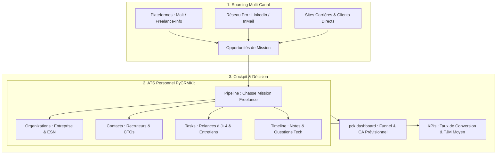

# Analyse Exhaustive : Recherche de Mission Freelance, Pilotage de Candidatures & KPIs avec PyCRMKit

> **Document de Référence Métier, Stratégie & Analytics**  
> **Auteur** : Thomas Awounfouet / WebTech Forge  
> **Cible** : Développeur freelance, artisan tech indépendant en période de prospection ou d'inter-contrat  
> **Modèle Métier** : ATS Personnel (Applicant Tracking System) & Entonnoir de Vente Outbound B2B  
> **Version PyCRMKit** : >= 1.2.0  
> **Statut** : Validé

---

## 1. Contexte : La Chasse de Mission comme Processus de Vente B2B

Pour un développeur freelance, la période d'inter-contrat ou de recherche de mission est fréquemment vécue comme une phase anxiogène. L'erreur la plus courante consiste à aborder cette étape de manière passive et désorganisée :
* Postuler en masse sur des plateformes sans suivi centralisé.
* Oublier de relancer les recruteurs sous prétexte qu'« ils répondront s'ils sont intéressés ».
* Arriver en entretien sans se rappeler du nom du CTO, du TJM initialement proposé, ni de la stack exacte mentionnée dans l'offre.
* Perdre la trace de dizaines de contacts RH de grande valeur dès qu'une mission est finalement trouvée.

### Le Changement de Paradigme
En freelance, **la recherche de mission n'est pas une simple quête d'emploi : c'est une campagne commerciale Outbound B2B** où :
* **Le Produit** : Votre expertise technique (Django, React, Cloud, Data, etc.) et votre autonomie.
* **Le Modèle de Revenu** : Votre TJM (Taux Journalier Moyen) $\times$ la durée estimée de la prestation.
* **Les Prospects** : Les clients finaux, startups, ESN et cabinets de recrutement.
* **Le CRM** : Votre ATS personnel garantissant qu'aucune piste ne tombe dans l'oubli et que chaque opportunité est exploitée au maximum.

---

## 2. Cartographie Métier dans PyCRMKit

PyCRMKit s'adapte immédiatement à ce cas d'usage sans modifier le code source du framework, grâce à son architecture modulaire :



#### Équivalent Schéma ASCII :
```text
┌─────────────────────────────────────────────────────────────────────────┐
│                       1. SOURCING MULTI-CANAL                           │
│                                                                         │
│   [ Plateformes Spécialisées ]       [ Réseau LinkedIn ]   [ Direct ]   │
│   (Malt, Freelance-Info, Comet)      (InMails, Posts)      (Clients)    │
│                 │                            │                 │        │
│                 └────────────────────┬───────┴─────────────────┘        │
│                                      │                                  │
│                                      ▼                                  │
│                        [ Opportunités de Missions ]                     │
└──────────────────────────────────────┬──────────────────────────────────┘
                                       │
                                       ▼
┌─────────────────────────────────────────────────────────────────────────┐
│                    2. ATS PERSONNEL (PyCRMKit Core)                     │
│                                                                         │
│   • Organizations : Entreprise cliente finale ou ESN intermédiaire      │
│   • Contacts      : Recruteur RH, Talent Acquisition, CTO évaluateur    │
│   • Pipeline      : Entonnoir d'évaluation et de progression            │
│   • Tasks         : Relances disciplinées (J+4) & préparation d'appels  │
│   • Timeline      : Comptes-rendus d'entretiens & questions techniques  │
└──────────────────────────────────────┬──────────────────────────────────┘
                                       │
                                       ▼
┌─────────────────────────────────────────────────────────────────────────┐
│                    3. COCKPIT ANALYTIQUE & DÉCISION                     │
│                                                                         │
│   • pck dashboard : Cartes KPIs, CA Prévisionnel pondéré & Funnel visuel│
│   • Ratios clés   : Taux de conversion par canal, TJM moyen négocié     │
└─────────────────────────────────────────────────────────────────────────┘
```

| Concept Recrutement | Équivalent PyCRMKit | Données Concrètes Stockées |
|---|---|---|
| **L'Entreprise qui recrute** | `crm.organizations` | Nom, secteur d'activité, site web, statut (Client direct vs ESN). |
| **Le Recruteur / Le CTO** | `crm.contacts` | Nom, email, téléphone, profil LinkedIn, rôle dans la décision. |
| **L'Offre de Mission** | `crm.opportunities` | Intitulé, montant total estimé (TJM $\times$ jours), probabilité d'embauche. |
| **Le Processus de Recrutement** | `crm.pipelines` | Pipeline dédié `freelance-job-hunt` avec étapes franchies une à une. |
| **Les Spécificités du Poste** | `crm.custom_fields` | `plateforme_source`, `tjm_demande`, `rythme_remote`, `lien_offre`, `stack_requise`. |
| **Les Relances & Préparations** | `crm.tasks` | Rappels datés (`HIGH` / `URGENT`) pour relancer ou préparer un live coding. |
| **L'Historique des Entretiens** | `crm.timeline` | Questions pièges posées, impressions sur l'équipe, retours RH. |

---

## 3. Le Pipeline d'Entonnoir de Candidature

Le pipeline de chasse de mission modélise les passages d'étapes éliminatoires :


#### Équivalent Schéma ASCII :
```text
┌─────────────────┐     ┌─────────────────────┐     ┌──────────────────────┐
│  1. VEILLE &    │     │   2. CANDIDATURE    │     │   3. SCREENING       │
│    REPÉRAGE     │ ──► │      ENVOYÉE        │ ──► │      RH / ESN        │
│ (Malt/LinkedIn) │     │ (CV + Pitch TJM)    │     │  (Call 15-20 min)    │
└─────────────────┘     └─────────────────────┘     └──────────┬───────────┘
                                                               │
                                                               ▼
┌─────────────────┐     ┌─────────────────────┐     ┌──────────────────────┐
│  6. OFFRE &     │     │  5. ENTRETIEN       │     │  4. ENTRETIEN        │
│   NÉGOCIATION   │ ◄── │   CLIENT FINAL      │ ◄── │   TECH / CTO         │
│ (TJM & Date Dém)│     │  (Pour les ESN)     │     │ (Live coding / Démo) │
└────────┬────────┘     └─────────────────────┘     └──────────────────────┘
         │
         ├─────────────────────────────────────────┐
         ▼ (Accord)                                ▼ (Refus / Timing / Budget)
┌─────────────────────────────────────┐   ┌──────────────────────────────────┐
│        7. MISSION DÉCROCHÉE 🎉      │   │    8. ARCHIVÉ (Avec Motif)       │
│  (Contrat signé, date calée)        │   │ (Garder le contact pour futur)   │
└─────────────────────────────────────┘   └──────────────────────────────────┘
```

---

## 4. Système de Mesure : Les 4 Familles de KPIs Stratégiques

Piloter sa recherche de mission sans KPIs revient à naviguer à l'aveugle. PyCRMKit permet de calculer automatiquement quatre catégories d'indicateurs :

### 4.1. Famille 1 : KPIs d'Entonnoir & Taux de Conversion

Ces indicateurs diagnostiquent **où se situent vos forces et vos axes d'amélioration** dans le cycle de sélection :

* **Taux de réponse initial** :
  $$\text{Taux de Réponse} = \frac{\text{Screenings RH Obtenus}}{\text{Candidatures Envoyées}} \times 100$$
  * *Interprétation* : Si ce taux est inférieur à 15-20%, votre CV, votre profil Malt/LinkedIn ou votre accroche ne retiennent pas l'attention.
* **Taux de qualification technique** :
  $$\text{Taux Tech} = \frac{\text{Entretiens Techniques Validés}}{\text{Screenings RH Réalisés}} \times 100$$
  * *Interprétation* : Mesure l'alignement entre le besoin fonctionnel du client et votre positionnement technique.
* **Taux de closing final (Win Rate)** :
  $$\text{Win Rate} = \frac{\text{Missions Remportées (Won)}}{\text{Total Décidé (Won + Lost)}} \times 100$$

### 4.2. Famille 2 : KPIs Financiers & TJM

* **Valeur Brute du Pipeline** : Somme des honoraires potentiels des opportunités ouvertes ($\text{TJM} \times \text{Durée en jours}$).
* **CA Prévisionnel Pondéré (*Weighted Forecast*)** :  
  Permet d'anticiper vos rentrées financières réelles en pondérant chaque mission par sa probabilité d'aboutir :
  $$\text{CA Pondéré} = \sum (\text{Valeur de la Mission} \times \text{Probabilité de l'Étape})$$
  * Candidature envoyée : **20%**
  * Screening RH passé : **40%**
  * Entretien CTO validé : **70%**
  * Offre reçue en négociation : **90%**
* **TJM Moyen Cible vs TJM Réel Signé** : Mesure l'érosion éventuelle de vos tarifs en phase de négociation.

### 4.3. Famille 3 : Performance & Rentabilité par Canal de Sourcing

Tous les canaux d'acquisition ne se valent pas en freelance. Grâce aux attributs de PyCRMKit, vous comparez leur efficacité :

| Canal de Prospection | Volume Postulé | Taux de Conversion | TJM Moyen Constaté | Constat Stratégique |
|---|---|---|---|---|
| **Réseau / Prescripteurs** | Faible (3) | **66%** | **650 €** | Canal le plus rentable et le plus rapide. |
| **Malt (Inbound)** | Moyen (8) | **38%** | **600 €** | Forte qualification mais commission plateforme. |
| **ESN / Intermédiaires** | Élevé (15) | **20%** | **550 €** | Processus long (2 entretiens) et TJM plus bas. |
| **LinkedIn Outbound** | Élevé (25) | **8%** | **580 €** | Chronophage, nécessite un volume important. |

### 4.4. Famille 4 : Vélocité & Rigueur Opérationnelle

* **Durée moyenne du cycle de recrutement** : Nombre moyen de jours entre le premier contact et la signature (ex: 12 jours en direct vs 28 jours via ESN).
* **Indicateur de retard de relance (*Overdue Task Ratio*)** : Nombre de relances en retard par rapport aux relances prévues. La clé du succès en freelance est de relancer systématiquement à J+4.

---

## 5. Rendu Visuel Opérationnel dans la CLI (`pck dashboard`)

Dans votre quotidien, vous visualisez l'ensemble de ces métriques d'un seul coup d'œil grâce au cockpit exécutif de PyCRMKit :

```text
╭──────────────────────────────────────────────────────────────────────────────────────╮
│  🏢 PyCRMKit Executive Command Center  •  v1.2.0                                     │
│  Real-time Operational Telemetry & Commercial Funnel Analytics                       │
╰──────────────────────────────────────────────────────────────────────────────────────╯
┌─────────────────────────┐   ┌─────────────────────────┐   ┌──────────────────────────┐
│  💼 Active Pipeline     │   │  🎯 Weighted Revenue    │   │  🏆 Closed Won           │
│  72,000.00 €            │   │  28,500.00 €            │   │  36,000.00 €             │
│  4 missions en cours    │   │  CA prévisionnel pondéré│   │  Win Rate: 33% (1 signé) │
└─────────────────────────┘   └─────────────────────────┘   └──────────────────────────┘

                         Commercial Sales Funnel & Deal Velocity
┏━━━━━━━━━━━━━━━━━━━━━━━━━━━━━┳━━━━━━━┳━━━━━━━━━━━━━━┳━━━━━━━━━━━━━━┳━━━━━━━━━━━━━━━━━━━━━━━━━━━━┓
┃ Étape de la Recherche       ┃ Deals ┃ Valeur Brute ┃ CA Pondéré   ┃ Répartition de l'Entonnoir ┃
┡━━━━━━━━━━━━━━━━━━━━━━━━━━━━━╇━━━━━━━╇━━━━━━━━━━━━━━╇━━━━━━━━━━━━━━╇━━━━━━━━━━━━━━━━━━━━━━━━━━━━┩
│ 1. Candidature Envoyée (20%)│   2   │   36,000.00 €│    7,200.00 €│ ██████████░░░░░░░░░░ 50%   │
│ 2. Screening RH / ESN  (40%)│   1   │   18,000.00 €│    7,200.00 €│ █████░░░░░░░░░░░░░░░ 25%   │
│ 3. Entretien Tech CTO  (70%)│   1   │   18,000.00 €│   12,600.00 €│ █████░░░░░░░░░░░░░░░ 25%   │
│ 4. Mission Décrochée  (100%)│   1   │   36,000.00 €│   36,000.00 €│ 🏆 Gagné                   │
└─────────────────────────────┴───────┴──────────────┴──────────────┴────────────────────────────┘

                          Action Items & Priorités Immédiates
┏━━━━━━━━━━┳━━━━━━━━━━━━━━━━━━━━━━━━━━━━━━━━━━━━━━━━━━━━━━━━━━━━┳━━━━━━━━━━━━┳━━━━━━━━━━━┓
┃ Priorité ┃ Action / Relance à Mener                           ┃ Date Limite┃ Statut    ┃
┡━━━━━━━━━━╇━━━━━━━━━━━━━━━━━━━━━━━━━━━━━━━━━━━━━━━━━━━━━━━━━━━━╇━━━━━━━━━━━━╇━━━━━━━━━━━┩
│ 🔴 HIGH  ┃ Relance Sophie Girard sur LinkedIn (FinTech Nova)  │ 2026-11-04 │ À faire   │
│ 🟡 NORMAL┃ Préparer questions archi microservices call CTO    │ 2026-11-06 │ À faire   │
└──────────┴────────────────────────────────────────────────────┴────────────┴───────────┘
```

---

## 6. Guide Pas à Pas : Piloter sa Recherche en Ligne de Commande

### Étape 1 : Veille et repérage d'une offre sur une plateforme
Vous trouvez une annonce intéressante sur Malt ou Freelance-Info.
```bash
# Création de l'entreprise et du contact recruteur
pck orgs create --name "DataPulse Solutions" --industry "Big Data / Cloud"
pck contacts create --first-name "Guillaume" --last-name "Vasseur" --email "g.vasseur@datapulse.io"

# Rattachement des informations spécifiques à l'offre
pck orgs update <org-id> \
    --custom "lien_offre:https://www.malt.fr/profile/mission/xxx" \
    --custom "stack_demandee:Python 3.12 / FastAPI / PySpark / GCP"
```

### Étape 2 : Postuler et cadencer la relance
Vous envoyez votre candidature avec votre TJM cible (ex: 650 €/j sur 3 mois = 39 000 €).
```bash
# Création de l'opportunité dans le pipeline
pck sales opps  # Contrôle des opportunités existantes

# Programmation de la relance obligatoire à J+4
pck tasks create \
    --title "Relancer Guillaume Vasseur (DataPulse) si pas de retour sous 4j" \
    --priority HIGH \
    --due "2026-11-05"
```

### Étape 3 : Passage du screening RH et préparation du test tech
Le recruteur vous contacte pour un premier call de 20 minutes qui est concluant.
```bash
# Avancement de l'étape
pck sales move <deal-id> entretien_tech --pipeline freelance-job-hunt

# Consignation des attentes du CTO dans la fiche
pck contacts show <contact-id>
```

### Étape 4 : Décrochage de la mission et bascule vers le delivery
Le client final valide votre candidature.
```bash
# Clôture gagnante du deal
pck sales move <deal-id> won --pipeline freelance-job-hunt

# Bascule immédiate dans votre pipeline opérationnel d'agence / delivery !
pck sales move <deal-id> specifications --pipeline agency-software-delivery
```

---

## 7. Recette Python Prête à l'Emploi

Ce script configure l'ensemble des définitions de champs, tags et étapes pour votre recherche de mission :

```python
"""Configuration complète du module ATS / Chasse de Mission Freelance dans PyCRMKit."""

from decimal import Decimal
from pycrmkit.core.pagination import OffsetPageRequest
from pycrmkit.facade.crm import CRM
from pycrmkit.opportunities import OpportunityStatus


def setup_freelance_mission_hunt(crm: CRM) -> None:
    # 1. Pipeline de Chasse de Mission Freelance
    crm.pipelines.create(
        name="Chasse Mission Freelance",
        stages=[
            "veille_reperee",      # Offre identifiée, à qualifier
            "candidature_envoyee", # CV, TJM et message envoyés
            "screening_rh",        # Call d'échange préliminaire RH / ESN
            "entretien_tech",      # Entretien technique / CTO
            "entretien_final",     # Validation client final (si ESN)
            "offre_recue",         # Négociation TJM & conditions
            "won",                 # Mission remportée !
            "lost",                # Candidature refusée ou abandonnée
        ],
    )

    # 2. Définitions de Custom Fields pour les offres de mission
    crm.custom_fields.define(entity_kind="opportunity", name="plateforme_source", field_type="string")
    crm.custom_fields.define(entity_kind="opportunity", name="tjm_demande", field_type="number")
    crm.custom_fields.define(entity_kind="opportunity", name="modalite_teletravail", field_type="string")
    crm.custom_fields.define(entity_kind="opportunity", name="lien_annonce", field_type="string")
    crm.custom_fields.define(entity_kind="opportunity", name="motif_refus", field_type="string")

    # 3. Tags d'organisation et de segmentation
    crm.tags.create(name="client-direct", color="#10B981")     # Vert (marge optimale)
    crm.tags.create(name="intermediaire-esn", color="#3B82F6") # Bleu
    crm.tags.create(name="full-remote", color="#8B5CF6")       # Violet
    crm.tags.create(name="recontacter-futur", color="#F59E0B") # Jaune
    crm.tags.create(name="tjm-premium", color="#EC4899")       # Rose (> 700€)

    print("🎯 Pipeline et métadonnées ATS Chasse de Mission initialisés avec succès !")


def compute_hunt_kpis(crm: CRM) -> dict[str, object]:
    """Extrait les KPIs consolidés de la recherche de mission."""
    opps = crm.opportunities.list(page=OffsetPageRequest(limit=250)).items
    won = [o for o in opps if o.status == OpportunityStatus.WON]
    lost = [o for o in opps if o.status == OpportunityStatus.LOST]
    open_deals = [o for o in opps if o.status == OpportunityStatus.OPEN]

    total_decided = len(won) + len(lost)
    win_rate = (len(won) / total_decided * 100) if total_decided > 0 else 0.0
    active_pipeline_val = sum((o.estimated_value or Decimal(0)) for o in open_deals)
    weighted_forecast = sum(
        ((o.estimated_value or Decimal(0)) * (o.probability or Decimal(0))) for o in open_deals
    )

    return {
        "candidatures_totales": len(opps),
        "candidatures_actives": len(open_deals),
        "missions_decrochees": len(won),
        "win_rate_pct": round(win_rate, 1),
        "pipeline_brut_eur": active_pipeline_val,
        "ca_previsionnel_pondere_eur": weighted_forecast,
    }


if __name__ == "__main__":
    crm = CRM()
    setup_freelance_mission_hunt(crm)
    kpis = compute_hunt_kpis(crm)
    print("KPIs actuels :", kpis)
```

---

## 8. Conclusion : Les Bénéfices Stratégiques et Psychologiques

L'application de PyCRMKit à la recherche de mission freelance transforme radicalement votre position sur le marché :

1. **Sérénité & Fin du Stress de l'Inter-Contrat** :  
   Plutôt que de ruminer l'incertitude, vous visualisez un **pipeline chiffré en euros** progresser de jour en jour.
2. **Postion de Force en Négociation** :  
   Un développeur qui a 4 opportunités actives dans son entonnoir ne brade pas son TJM. Il sait que son CA prévisionnel est sécurisé.
3. **Optimisation Continue par la Mesure** :  
   Si votre taux de conversion chute entre le screening RH et l'entretien CTO, vous identifiez immédiatement le problème et ajustez votre discours technique.
4. **Capitalisation Patrimoniale de Réseau** :  
   Dans 6 mois ou 1 an, quand votre mission actuelle se terminera, vous n'aurez pas à recommencer de zéro : votre carnet de recruteurs, CTOs et prescripteurs sera déjà qualifié, annoté et prêt à être réactivé en 24 heures.
