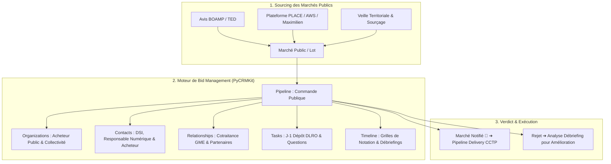
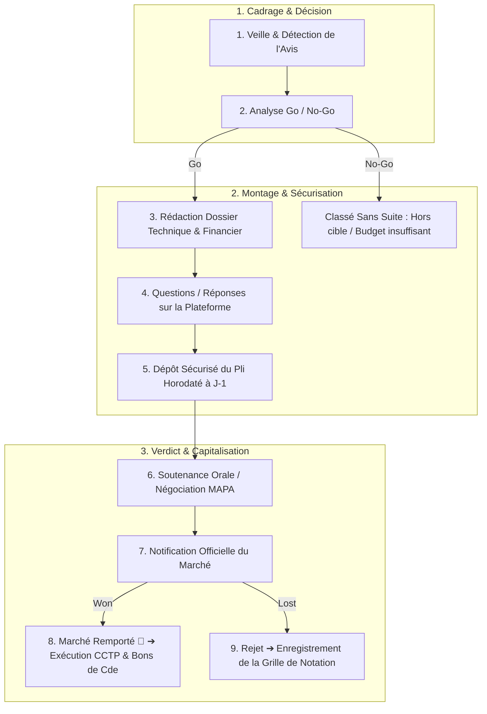
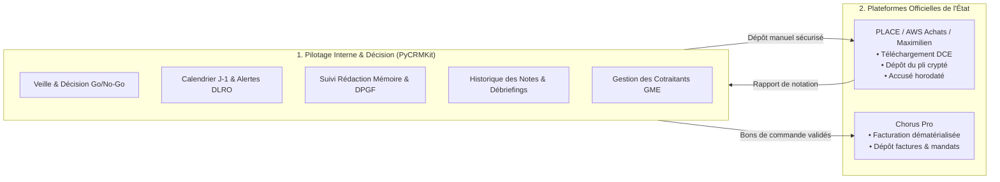

# Analyse Exhaustive : Commande Publique, Appels d'Offres & Bid Management d'Agence Web avec PyCRMKit

> **Document de Référence Métier, Stratégie & Procédures**  
> **Auteur** : Thomas Awounfouet / WebTech Forge  
> **Cible** : Développeur solo, agence web, studio tech répondant aux marchés publics  
> **Cadre Juridique & Opérationnel** : Code de la commande publique (France / UE), MAPA, Accords-cadres, Dématérialisation  
> **Version PyCRMKit** : >= 1.2.0  
> **Statut** : Validé

---

## 1. Contexte : Les Spécificités de la Commande Publique

La commande publique (marchés de l'État, des collectivités territoriales, des universités, des hôpitaux et des établissements publics) représente un gisement d'activité majeur pour une agence web ou un artisan développeur :
* **Budgets garantis** : Zéro risque d'impayé client.
* **Visibilité pluriannuelle** : Les accords-cadres à bons de commande sécurisent du chiffre d'affaires récurrent sur 2 à 4 ans.
* **Projets à fort impact citoyen** : Plateformes de services publics, portails territoriaux, open data, accessibilité numérique (RGAA).

### Mais pourquoi la commande publique est-elle si redoutée ?
Contrairement à la vente privée où la négociation est souple et informelle, **la commande publique est hyper-réglementée** :
1. **La Date et Heure Limite de Remise des Plis (DLRO) est impitoyable** : Un pli envoyé avec 3 secondes de retard sur la plateforme est rejeté sans recours possible.
2. **La charge de réponse est colossale** : Rédaction d'un Mémoire Technique sur-mesure au CCTP (20 à 50 pages), formulaires administratifs (DC1, DC2, DUME, attestations fiscales et sociales), décomposition des prix (BPU, DQE, DPGF).
3. **Le risque du "No-Go trop tardif"** : Passer 40 heures à répondre à un appel d'offres mal qualifié ou verrouillé par un concurrent sortant.
4. **La cotraitance fréquente** : Pour remporter des lots complets, le dev solo doit s'associer en groupement momentané d'entreprises (GME) avec d'autres experts (accessibilité, design, hébergement SecNumCloud).

**PyCRMKit apporte la structure, le calendrier et la mémoire indispensables pour transformer cette contrainte administrative en un avantage compétitif reproductible.**

---

## 2. Cartographie Métier dans PyCRMKit



#### Équivalent Schéma ASCII :
```text
┌─────────────────────────────────────────────────────────────────────────────┐
│                    1. SOURCING DES MARCHÉS PUBLICS                          │
│                                                                             │
│   [ Plateformes Officielles ]      [ Profils d'Acheteurs ]    [ Veille ]    │
│   (BOAMP, TED, JOUE)               (PLACE, AWS, Maximilien)   (Sourçage)    │
│                 │                             │                   │         │
│                 └─────────────────────┬───────┴───────────────────┘         │
│                                       │                                     │
│                                       ▼                                     │
│                         [ Marché Public / Lot Identifié ]                   │
└───────────────────────────────────────┬─────────────────────────────────────┘
                                        │
                                        ▼
┌─────────────────────────────────────────────────────────────────────────────┐
│                 2. MOTEUR DE BID MANAGEMENT (PyCRMKit Core)                 │
│                                                                             │
│   • Organizations : Pouvoir adjudicateur (Mairie, Conseil Régional, DSI)    │
│   • Contacts      : Chef de projet numérique territorial, Responsable achats│
│   • Relationships : Groupements Momentanés d'Entreprises (Cotraitance GME)  │
│   • Pipeline      : Entonnoir rigide de réponse (Veille ➔ Go/No-Go ➔ Dépôt) │
│   • Tasks         : Sécurisation DLRO à J-1 & Calendrier questions/réponses │
│   • Timeline      : Historisation des débriefings et grilles de notation    │
└───────────────────────────────────────┬─────────────────────────────────────┘
                                        │
                                        ▼
┌─────────────────────────────────────────────────────────────────────────────┐
│                       3. VERDICT & EXÉCUTION DU MARCHÉ                      │
│                                                                             │
│   • Notification d'Attribution (Won) ──► Bascule dans Pipeline Delivery CCTP│
│   • Notification de Rejet (Lost)     ──► Analyse d'écart sur les notes      │
└─────────────────────────────────────────────────────────────────────────────┘
```

| Concept Marché Public | Entité PyCRMKit | Données Concrètes Stockées |
|---|---|---|
| **L'Acheteur Public** | `crm.organizations` | Nom, SIRET, code acheteur, service prescripteur (ex: *Conseil Départemental - Direction du Numérique*). |
| **Le Prescripteur / Acheteur** | `crm.contacts` | DSI, Responsable Numérique territorial, Acheteur public de la commission des marchés. |
| **Le Marché / Le Lot** | `crm.opportunities` | Référence de consultation, lot, montant estimé (forfait ou montant max d'accord-cadre), devise EUR. |
| **La Procédure** | `crm.pipelines` | Pipeline dédié `public-tenders-bid-management` avec jalons éliminatoires. |
| **Cotraitance & Partenaires** | `crm.relationships` | Groupement momentané d'entreprises : `role="Mandataire"` ou `role="Cotraitant"`. |
| **Métadonnées Réglementaires** | `crm.custom_fields` | `reference_marche`, `type_procedure` (MAPA, AO Ouvert), `dlro_datetime`, `plateforme_depot`, `note_technique`, `note_prix`. |
| **Dates Couperets (DLRO)** | `crm.tasks` | Tâche de dépôt sécurisé à J-1 avec alerte `URGENT`, date limite de pose des questions sur le profil d'acheteur. |
| **Grilles de Notation** | `crm.timeline` | Consignation des notes obtenues au rapport d'analyse des offres (technique et prix). |

---

## 3. Le Pipeline d'Appel d'Offres : De la Détection au Débriefing

Le cycle de réponse à un marché public ne souffre aucune improvisation. PyCRMKit permet d'ordonnancer les étapes :



#### Équivalent Schéma ASCII :
```text
┌─────────────────────────────────────────────────────────────────────────────┐
│                          1. CADRAGE & DÉCISION                              │
│                                                                             │
│   [ 1. Veille & Détection de l'Avis ] (BOAMP, PLACE, AWS, Profil Acheteur)  │
│                 │                                                           │
│                 ▼                                                           │
│   [ 2. Analyse Go / No-Go ] (Capacité technique, délais, marge, solvabilité)│
│         │                                                                   │
│         ├──────────────────────────────────┐ (No-Go justifié)               │
│         ▼ (Go)                             ▼                                │
│                                  [ Classé Sans Suite ]                      │
└─────────┼───────────────────────────────────────────────────────────────────┘
          │
          ▼
┌─────────┼───────────────────────────────────────────────────────────────────┐
│         ▼                2. MONTAGE & SÉCURISATION                          │
│                                                                             │
│   [ 3. Rédaction du Dossier de Réponse ]                                    │
│        • Candidature : DC1, DC2, DUME, attestations fiscales/sociales       │
│        • Offre technique : Mémoire technique sur-mesure au CCTP             │
│        • Offre financière : BPU / DQE / DPGF                                │
│                 │                                                           │
│                 ▼                                                           │
│   [ 4. Questions / Réponses sur la Plateforme Acheteur ]                    │
│                 │                                                           │
│                 ▼ (Dépôt impératif à J-1 avant la date limite DLRO)         │
│   [ 5. Dépôt Sécurisé du Pli Dématérialisé avec Accusé ]                    │
└─────────┼───────────────────────────────────────────────────────────────────┘
          │
          ▼
┌─────────┼───────────────────────────────────────────────────────────────────┐
│         ▼                3. VERDICT & CAPITALISATION                        │
│                                                                             │
│   [ 6. Audition Orale / Soutenance Technique / Négociation MAPA ]           │
│                 │                                                           │
│                 ▼                                                           │
│   [ 7. Notification Officielle du Pouvoir Adjudicateur ]                    │
│         │                                                                   │
│         ├──────────────────────────────────┐                                │
│         ▼ (Marché attribué)                ▼ (Offre rejetée)                │
│   [ 8. Marché Remporté 🎉 ]          [ 9. Rejet & Analyse Débriefing ]      │
│   (Bascule delivery CCTP & Chorus)   (Archivage grille notation CCTP/Prix)  │
└─────────────────────────────────────────────────────────────────────────────┘
```

---

## 4. Les 4 Leviers Stratégiques pour Gagner des Marchés Publics avec PyCRMKit

### 4.1. Levier 1 : La Décision « Go / No-Go » Rapide et Rationnelle

Répondre à un appel d'offres sans filtre est le moyen le plus rapide d'épuiser une agence.  
Dans PyCRMKit, chaque avis détecté entre dans l'étape `analyse_go_no_go`. Vous appliquez une grille stricte :
1. **Éligibilité technique** : Maîtrisons-nous 90% de la stack demandée dans le CCTP ?
2. **Pondération des critères** : Le prix pèse-t-il plus de 60% ? *(Si oui, risque de guerre des prix avec des sous-traitants low-cost $\rightarrow$ No-Go).*
3. **Délai de réalisation** : Le calendrier imposé est-il réaliste avec notre capacité de delivery ?
4. **Volume financier** : Le montant prévisionnel couvre-t-il largement nos charges et notre marge ?

Si un critère échoue, l'opportunité passe en `lost` avec le motif documenté (`no_go_critere_prix`). **Vous préservez ainsi 100% de votre temps de production.**

### 4.2. Levier 2 : La Sécurisation Absolue de la Date Limite (DLRO)

L'article R. 2151-5 du Code de la commande publique est sans appel : les plis transmis hors délai sont éliminés sans ouverture.  
La pratique du secteur démontre que déposer le jour même expose aux incidents : serveur du profil d'acheteur saturé, certificat électronique révoqué, connexion Internet coupée.

**Avec PyCRMKit** :
* La DLRO officielle est enregistrée dans le champ `dlro_datetime`.
* La tâche de dépôt dans `pck tasks` est automatiquement programmée à **J-1, à 16h00**, avec priorité `URGENT`.
* Si le pli n'est pas déposé à J-1, une alerte visuelle rouge vif apparaît dans le cockpit `pck dashboard`.

### 4.3. Levier 3 : La Capitalisation Continue des Débriefings

En marché public, l'article R. 2181-1 impose à l'acheteur de communiquer à tout candidat évincé :
* Les motifs du rejet de sa candidature ou de son offre.
* Le nom de l'attributaire retenu.
* Les notes détaillées attribuées à son offre sur chaque sous-critère technique et sur le prix.

**L'énorme avantage de PyCRMKit** :
Au lieu de ranger ce courrier dans un tiroir avec déception, vous le consignez dans la `crm.timeline` du compte public :
* `📝 Note : Rejet marché refonte portail Mairie de X. Note technique : 54/60 (très bon mémoire sur l'accessibilité). Note prix : 26/40 (nous étions 12% plus cher que l'attributaire). Leçon : Réajuster le BPU sur la phase de recette.`

Au bout de 6 mois, **votre CRM contient un trésor d'intelligence économique** sur les prix réels et les attentes des collectivités de votre région.

### 4.4. Levier 4 : La Gestion des Groupements (Cotraitance GME)

En tant qu'artisan dev ou agence web boutique, vous n'avez pas toujours toutes les casquettes exigées par un CCTP global (ex: développement web + audit accessibilité RGAA + hébergement certifié HDS/SecNumCloud + design de marque).

Grâce à [`RelationshipsAPI`](file:///Users/awf/workspace/professionnal/webtech/packages/pycrmkit/src/pycrmkit/facade/relationships.py), vous modélisez formellement vos alliances :
```python
# Lier l'agence de design au marché en tant que cotraitant
crm.relationships.create(
    source=EntityReference("organization", org_agence_web.id),
    target=EntityReference("organization", org_partenaire_design.id),
    relationship_type="gme_partner",
    role="Cotraitant UI/UX & Charte Graphique",
    metadata={"quote_part_financiere": "30%", "convention_groupement": True}
)
```
Vous gardez un historique clair des agences partenaires fiables avec lesquelles vous remportez des marchés.

---

## 5. Architecture d'Intégration : PyCRMKit vs Plateformes de l'État

Il convient de distinguer nettement les responsabilités au sein du système d'information de l'agence :



#### Équivalent Schéma ASCII :
```text
┌─────────────────────────────────────────┐             ┌─────────────────────────────────────────┐
│     1. PILOTAGE INTERNE (PyCRMKit)      │             │     2. PLATEFORMES OFFICIELLES ÉTAT     │
│                                         │             │                                         │
│ • Veille & Décision stricte Go / No-Go  │             │ • Profils d'Acheteurs (PLACE / AWS / ...)│
│ • Verrouillage DLRO à J-1 & Alertes CLI │ ──────────► │   - Téléchargement du DCE (CCTP / RC)   │
│ • Suivi de rédaction du mémoire tech    │ (Dépôt Pli  │   - Dépôt légal dématérialisé crypté    │
│ • Suivi de cotraitance GME partenaires  │  Sécurisé)  │   - Accusé de réception officiel        │
│ • Base de données des grilles de notes  │ ◄────────── │                                         │
│ • Suivi des livrables CCTP en cours     │ (Notation & │ • Chorus Pro                            │
│                                         │  Débriefing)│   - Facturation dématérialisée légale   │
│                                         │             │   - Rapprochement mandats administratifs│
└─────────────────────────────────────────┘             └─────────────────────────────────────────┘
```

---

## 6. Guide Pas à Pas : Répondre à un Marché Public en Ligne de Commande (`pck`)

### Étape 1 : Détection d'un marché au BOAMP
Vous repérez l'avis suivant : *"Marché Public de Refonte du Portail Citoyen - Ville de Métropole Ouest - Procédure MAPA - Budget max : 45 000 € HT"*.

```bash
# 1. Création de l'acheteur public et du contact prescripteur
pck orgs create --name "Ville de Métropole Ouest" --industry "Collectivité Territoriale"
pck contacts create --first-name "Laurent" --last-name "Morel" --email "l.morel@metropoleouest.fr"

# 2. Enregistrement des données du marché
pck orgs update <org-id> \
    --custom "numero_marche:2026-MAPA-042" \
    --custom "dlro_datetime:2026-11-25 12:00" \
    --custom "plateforme_depot:PLACE (marches-publics.gouv.fr)"
```

### Étape 2 : Décision Go / No-Go et création de l'opportunité
L'analyse du CCTP confirme que les exigences techniques (FastAPI, React, RGAA niveau AA) correspondent parfaitement à vos compétences.

```bash
# Déplacement de l'opportunité dans le pipeline
pck sales move <deal-id> redaction_reponse --pipeline public-tenders-bid-management

# Verrouillage impératif du dépôt à J-1 (24 novembre à 15h00 au lieu du 25 à 12h00)
pck tasks create \
    --title "[DLRO J-1] Dépôt Pli Dématérialisé Refonte Portail Métropole Ouest" \
    --priority URGENT \
    --due "2026-11-24"
```

### Étape 3 : Dépôt du pli sur le profil d'acheteur
Le 24 novembre, vous déposez le fichier zip contenant le mémoire technique, le DC1, le DC2 et le bordereau de prix. Vous obtenez l'accusé de réception horodaté.

```bash
pck sales move <deal-id> depot_securise --pipeline public-tenders-bid-management
```

### Étape 4 : Notification de la décision
Le pouvoir adjudicateur vous informe que votre offre est retenue classée 1ère.

```bash
# 1. Validation de l'attribution
pck sales move <deal-id> won --pipeline public-tenders-bid-management

# 2. Tag de suivi institutionnel
pck orgs tag <org-id> add "marche-public-actif" "accord-cadre"

# 3. Bascule automatique dans le pipeline de Delivery pour exécuter le CCTP !
pck sales move <deal-id> specifications --pipeline agency-software-delivery
```

---

## 7. Recette Python Prête à l'Emploi

Ce script prêt à l'emploi configure les pipelines, custom fields et tags indispensables à la commande publique dans PyCRMKit :

```python
"""Module d'initialisation de l'environnement Commande Publique & Appels d'Offres dans PyCRMKit."""

from pycrmkit.core.references import EntityReference
from pycrmkit.facade.crm import CRM


def setup_public_procurement_crm(crm: CRM) -> None:
    # 1. Pipeline Commande Publique & Appels d'Offres
    crm.pipelines.create(
        name="Commande Publique - Appels d'Offres",
        stages=[
            "veille_detection",   # Avis BOAMP / PLACE repéré
            "analyse_go_no_go",   # Qualification éligibilité & rentabilité
            "redaction_reponse",  # Montage Mémoire Technique, DC1/DC2, DPGF
            "questions_acheteur", # Questions sur le profil d'acheteur
            "depot_securise",     # Pli déposé avec accusé de réception à J-1
            "audition_soutenance",# Soutenance orale ou négociation MAPA
            "won",                # Marché notifié et attribué
            "lost",               # Rejeté ou No-Go initial
        ],
    )

    # 2. Définitions de Custom Fields spécifiques aux marchés publics
    crm.custom_fields.define(entity_kind="opportunity", name="reference_marche", field_type="string")
    crm.custom_fields.define(entity_kind="opportunity", name="type_procedure", field_type="string") # MAPA, AO Ouvert
    crm.custom_fields.define(entity_kind="opportunity", name="dlro_datetime", field_type="string")
    crm.custom_fields.define(entity_kind="opportunity", name="plateforme_depot", field_type="string")
    crm.custom_fields.define(entity_kind="opportunity", name="note_technique", field_type="number")
    crm.custom_fields.define(entity_kind="opportunity", name="note_prix", field_type="number")
    crm.custom_fields.define(entity_kind="opportunity", name="classement_final", field_type="number")

    # 3. Custom Fields pour les acheteurs publics
    crm.custom_fields.define(entity_kind="organization", name="code_siret", field_type="string")
    crm.custom_fields.define(entity_kind="organization", name="service_prescripteur", field_type="string")

    # 4. Tags institutionnels
    crm.tags.create(name="secteur-public", color="#1E40AF")     # Bleu officiel
    crm.tags.create(name="mapa", color="#059669")               # Vert procédure adaptée
    crm.tags.create(name="accord-cadre", color="#7C3AED")       # Violet récurrent
    crm.tags.create(name="groupement-gme", color="#D97706")     # Ambre cotraitance
    crm.tags.create(name="marche-actif", color="#10B981")       # Émeraude en cours

    print("🏛️ Socle Commande Publique & Bid Management configuré avec succès dans PyCRMKit.")


if __name__ == "__main__":
    crm = CRM()
    setup_public_procurement_crm(crm)
```

---

## 8. Conclusion : De la Subordination Administrative à la Machine de Conquête

Gérer des appels d'offres sans outillage CRM est la cause principale d'échec des PME et indépendants face aux grandes ESN.  
En adoptant **PyCRMKit** pour votre démarche de commande publique :

1. **Vous ne perdez plus de temps sur les mauvais marchés** grâce à une phase Go / No-Go rigoureuse et formalisée.
2. **Vous éliminez le risque fatal de hors-délai** grâce au verrouillage des alertes de dépôt à J-1.
3. **Vous progressez à chaque candidature** en capitalisant méthodiquement vos notes techniques et financières dans l'historique du compte.
4. **Vous assurez la continuité parfaite après la victoire** : le marché public attribué bascule immédiatement dans votre pipeline de delivery pour suivre l'exécution du CCTP et la satisfaction de l'acheteur public.
