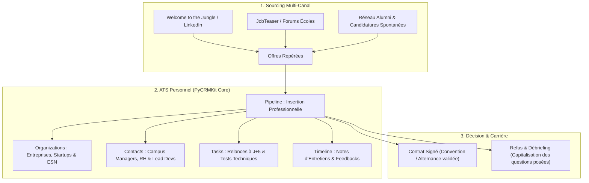
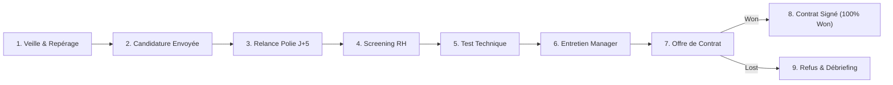

# Analyse Exhaustive : Recherche de Stages, Alternances & Premier Emploi (CDD/CDI) avec PyCRMKit

> **Document de Référence Méthodologique & Insertion Professionnelle**  
> **Auteur** : Thomas Awounfouet / WebTech Forge  
> **Cible** : Étudiants en informatique, alternants, jeunes diplômés, reconversions vers le dev  
> **Contrats Couverts** : Stage (3 à 6 mois), Alternance (12 à 24 mois), CDD, CDI Junior  
> **Version PyCRMKit** : >= 1.2.0  
> **Statut** : Validé

---

## 1. Contexte : Le Parcours du Combattant de l'Étudiant et du Junior

Sur le marché actuel de l'emploi technologique, les offres de stages, d'alternances et de postes juniors reçoivent entre 50 et 300 candidatures dans les premières 48 heures.  
Face à cette saturation, la majorité des étudiants commettent des erreurs méthodologiques pénalisantes :

1. **Le syndrome de l'envoi massif sans mémoire** : Postuler à des dizaines d'entreprises sur Welcome to the Jungle, LinkedIn ou JobTeaser, puis être pris au dépourvu lors d'un appel téléphonique surprise d'un recruteur (*« Bonjour, je vous appelle pour votre candidature... »* $\rightarrow$ *« Euh, c'est pour quelle entreprise déjà ? »*).
2. **Le silence radio subi (zéro relance)** : 90% des étudiants n'osent pas relancer. Or, un recruteur RH croule sous les CVs ; une relance courtoise et ciblée à J+5 multiplie par deux les chances d'obtenir un entretien.
3. **Le casse-tête des types de contrats** : Gérer simultanément des offres de stages de fin d'études et des alternances avec des rythmes scolaires disparates (3 jours / 2 jours, 3 semaines / 1 semaine).
4. **La justification auprès de l'école** : Les universités et écoles d'ingénieurs imposent de fournir un tableau de bord des démarches pour valider la période de recherche ou l'obtention du diplôme.

**PyCRMKit transforme cette quête stressante en une démarche d'ingénieur rigoureuse, mesurable et couronnée de succès.**

---

## 2. Cartographie Métier dans PyCRMKit

L'architecture de PyCRMKit s'adapte naturellement à la recherche d'emploi et d'alternance sous la forme d'un **ATS Personnel (Applicant Tracking System)** :



#### Équivalent Schéma ASCII :
```text
┌─────────────────────────────────────────────────────────────────────────────┐
│                       1. SOURCING MULTI-CANAL                               │
│                                                                             │
│   [ Welcome to the Jungle ]      [ Plateformes Écoles ]    [ Réseau Alumni ]│
│   (LinkedIn, Indeed)             (JobTeaser, Forums)       (Spontanées)     │
│                 │                         │                     │           │
│                 └─────────────────┬───────┴─────────────────────┘           │
│                                   │                                         │
│                                   ▼                                         │
│                    [ Offres de Postes Repérées ]                            │
└───────────────────────────────────┬─────────────────────────────────────────┘
                                    │
                                    ▼
┌─────────────────────────────────────────────────────────────────────────────┐
│                 2. ATS PERSONNEL (PyCRMKit Core)                            │
│                                                                             │
│   • Organizations : Entreprise ciblée (Scale-up, Startup, Grand groupe)     │
│   • Contacts      : Campus Manager, Recruteur RH, CTO ou Lead Dev           │
│   • Pipeline      : Entonnoir de sélection (Candidature ➔ Test ➔ Offre)     │
│   • Tasks         : Relances polies (J+5) & Rendu de tests techniques       │
│   • Timeline      : Notes d'entretiens et capitalisation des questions tech │
└───────────────────────────────────┬─────────────────────────────────────────┘
                                    │
                                    ▼
┌─────────────────────────────────────────────────────────────────────────────┐
│                      3. DÉCISION & INSERTION PRO                            │
│                                                                             │
│   • Contrat Signé 🎉 ──► Convention de stage / Contrat d'apprentissage      │
│   • Refus Constructif ──► Révision des lacunes techniques pour le futur     │
└─────────────────────────────────────────────────────────────────────────────┘
```

| Concept Étudiant / Recrutement | Entité PyCRMKit | Données Concrètes Stockées |
|---|---|---|
| **L'Entreprise qui recrute** | `crm.organizations` | Nom, secteur (Fintech, Edtech, etc.), taille, lien de la page Carrières. |
| **Le Recruteur ou l'Alumni** | `crm.contacts` | Nom, email, téléphone, profil LinkedIn, rôle (Campus Manager, Lead Dev, Ancien de l'école). |
| **L'Offre de Poste** | `crm.opportunities` | Titre du poste, montant (gratification mensuelle ou salaire brut annuel), probabilité de succès. |
| **Le Processus de Recrutement** | `crm.pipelines` | Pipeline dédié `student-career-launch` avec les étapes de validation. |
| **Les Modalités du Contrat** | `crm.custom_fields` | `type_contrat` (stage, alternance, cdi), `rythme_scolaire`, `plateforme_source`, `stack_exigee`. |
| **Les Échéances & Relances** | `crm.tasks` | Relance à J+5 (`HIGH`), date limite de rendu du test technique (Take-home code). |
| **L'Historique des Entretiens** | `crm.timeline` | Questions posées par le recruteur, points à retravailler, impressions sur l'équipe. |

---

## 3. Le Pipeline d'Insertion Professionnelle

Le pipeline modélise précisément chaque étape franchie par l'étudiant :



#### Équivalent Schéma ASCII :
```text
┌─────────────────┐     ┌─────────────────────┐     ┌──────────────────────┐
│  1. VEILLE &    │     │   2. CANDIDATURE    │     │   3. RELANCE POLIE   │
│    REPÉRAGE     │ ──► │      ENVOYÉE        │ ──► │       À J+5          │
│ (WTTJ, LinkedIn)│     │  (CV + Pitch adapté)│     │ (LinkedIn / Mail RH) │
└─────────────────┘     └─────────────────────┘     └──────────┬───────────┘
                                                               │
                                                               ▼
┌─────────────────┐     ┌─────────────────────┐     ┌──────────────────────┐
│  6. ENTRETIEN   │     │   5. TEST TECHNIQUE │     │   4. SCREENING       │
│    MANAGER      │ ◄── │      OU CAS         │ ◄── │      RH / RECRUTEUR  │
│ (Fit culturel)  │     │ (HackerRank, projet)│     │   (Visio 15-20 min)  │
└────────┬────────┘     └─────────────────────┘     └──────────────────────┘
         │
         ▼
┌─────────────────┐     ┌─────────────────────────────────────┐
│  7. OFFRE DE    │ ──► │         8. CONTRAT SIGNÉ 🎉         │
│    CONTRAT      │     │  (Convention de stage / Alternance) │
└────────┬────────┘     └─────────────────────────────────────┘
         │
         ▼ (Refus / Feedback)
┌─────────────────────────────────────┐
│       9. REFUS & DÉBRIEFING         │
│ (Capitaliser pour progresser)       │
└─────────────────────────────────────┘
```

---

## 4. Les 4 Super-Pouvoirs de l'Étudiant Équipé de PyCRMKit

### 4.1. Super-Pouvoir 1 : L'Anti-Gêne au Téléphone

Lorsqu'un Campus Manager ou un Lead Dev appelle à l'improviste sur son portable, l'étudiant moyen panique parce qu'il ne sait plus qui appelle.  
**Avec PyCRMKit** :
* En tapant `pck orgs show <nom>` ou `pck contacts show <nom>`, la fiche 360° s'affiche en **2 secondes** dans son terminal.
* L'étudiant voit immédiatement :
  * Le titre exact du poste.
  * Les 3 technos clés mentionnées dans l'annonce.
  * La note qu'il avait écrite en postulant (*« Insister sur mon projet open-source en FastAPI »*).
* **Effet recruteur** : Le candidat a l'air ultra-préparé, calme, motivé et professionnel.

### 4.2. Super-Pouvoir 2 : La Règle d'Or de la Relance à J+5

80% des recruteurs avouent ne pas avoir le temps d'ouvrir tous les CVs. Une relance bienveillante, courtoise et personnalisée à J+5 montre une vraie détermination.  
Dans PyCRMKit :
* Chaque candidature envoyée génère une tâche automatique :
  `pck tasks create --title "Relancer Clara (Campus Manager PayFit) sur LinkedIn" --due "2026-11-05"`.
* L'étudiant ne subit plus le stress de l'attente : il agit de manière cadencée.

### 4.3. Super-Pouvoir 3 : Le Mémoire d'Expérience et la Validation Pédagogique

À la fin du semestre, le responsable des stages ou le tuteur d'alternance demande des comptes : *« Montrez-moi ce que vous avez fait pour trouver une entreprise »*.  
L'étudiant classique bricole un tableur de mémoire.  
L'étudiant sous PyCRMKit peut sortir **un export exhaustif et documenté** montrant :
* 42 entreprises ciblées et qualifiées.
* 18 entretiens et tests techniques réalisés.
* Les ratios d'avancement et les motifs de refus documentés.
* **Résultat** : Validation pédagogique immédiate avec les félicitations du corps professoral pour la maturité démontrée.

### 4.4. Super-Pouvoir 4 : Le « Meta-Projet » en Entretien Technique

C'est l'argument ultime lors de l'entretien d'embauche avec un Lead Dev ou un CTO.  
Quand le recruteur pose la question classique :
> *« Parlez-moi d'un projet personnel où vous avez résolu un problème concret. »*

L'étudiant répond :
> *« Pour piloter ma recherche de stage / alternance, j'ai déployé un CRM personnel en Python. Il utilise une architecture hexagonale avec DDD, persiste mes données en base, et se pilote via une CLI Rich/Typer dans mon terminal. Cela m'a permis de modéliser mes candidatures comme un pipeline de vente, de mesurer mon taux de transformation et d'automatiser mes relances. »*

👉 **Le recruteur technique est conquis.** L'étudiant prouve qu'il ne se contente pas de coder des exercices d'école : **il résout ses propres problèmes avec du code propre et une mentalité d'ingénieur produit.**

---

## 5. Guide Pratique Quotidien en Ligne de Commande (`pck`)

### Étape 1 : Repérage d'une offre d'alternance sur Welcome to the Jungle
L'étudiant trouve une offre intéressante : *"Alternant Développeur Backend Python / Django - 12 mois - Swile (Montpellier / Remote)"*.

```bash
# 1. Création de l'entreprise et du recruteur
pck orgs create --name "Swile" --industry "Fintech / B2B SaaS"
pck contacts create --first-name "Maxime" --last-name "Perrin" --email "m.perrin@swile.co"

# 2. Ajout des critères scolaires et contractuels
pck orgs update <org-id> \
    --custom "type_contrat:Alternance 12 mois" \
    --custom "rythme:3 sem entreprise / 1 sem école" \
    --custom "remuneration:1450 EUR/mois" \
    --custom "stack:Python 3.12, Django, PostgreSQL, Docker"
```

### Étape 2 : Postuler et cadencer la relance
L'étudiant envoie son CV avec un email personnalisé. Il programme immédiatement sa relance.

```bash
# 1. Enregistrement de l'opportunité dans le pipeline
pck sales opps

# 2. Tâche de relance obligatoire à J+5
pck tasks create \
    --title "Relance polie Maxime Perrin sur LinkedIn (Candidature Swile)" \
    --priority HIGH \
    --due "2026-11-05"
```

### Étape 3 : Convocation au test technique
Le recruteur répond et transmet un test technique (projet GitHub à rendre sous 48h).

```bash
# 1. Déplacement de l'étape
pck sales move <deal-id> test_technique --pipeline student-career-launch

# 2. Création de la deadline de rendu du code
pck tasks create \
    --title "Rendu repo GitHub test technique Swile (API REST FastAPI)" \
    --priority URGENT \
    --due "2026-11-08"
```

### Étape 4 : Debriefing après l'entretien d'équipe
Après l'entretien avec le Lead Dev, l'étudiant consigne les points clés pour capitaliser.

```bash
# Consultation de la fiche contact
pck contacts show <contact-id>
# Ajout dans la timeline :
# "📝 Note : Super feeling avec l'équipe. Questions posées sur les transactions en base de données et Docker multi-stage builds. Points à réviser pour la suite : les index partiels en PostgreSQL."
```

### Étape 5 : Victoire et signature du contrat
L'entreprise transmet la proposition d'alternance validée.

```bash
# Clôture triomphale du deal
pck sales move <deal-id> won --pipeline student-career-launch

# Tag de victoire pour l'historique
pck orgs tag <org-id> add "alternance-validee" "promotion-2026"
```

---

## 6. Recette Python Prête à l'Emploi pour Étudiants & Juniors

Ce script autonome configure l'intégralité du module d'insertion professionnelle dans PyCRMKit :

```python
"""Module d'initialisation ATS & Insertion Professionnelle pour Étudiants dans PyCRMKit."""

from pycrmkit.facade.crm import CRM


def setup_student_career_crm(crm: CRM) -> None:
    # 1. Pipeline d'Insertion Professionnelle & Étudiante
    crm.pipelines.create(
        name="Insertion Professionnelle - Stages & Alternances",
        stages=[
            "veille_reperee",      # Offre identifiée (WTTJ, LinkedIn, etc.)
            "candidature_envoyee", # CV et message personnalisé transmis
            "relance_polie_j5",    # Relance polie par email ou LinkedIn
            "screening_rh",        # Entretien téléphonique préliminaire (15 min)
            "test_technique",      # Projet à la maison / Test d'algorithmique
            "entretien_manager",   # Échange approfondi avec l'équipe technique
            "offre_recue",         # Proposition de contrat reçue
            "won",                 # Contrat / Convention signée !
            "lost",                # Refus ou abandon
        ],
    )

    # 2. Champs spécifiques aux étudiants et contrats juniors
    crm.custom_fields.define(entity_kind="opportunity", name="type_contrat", field_type="string") # Stage, Alternance, CDI
    crm.custom_fields.define(entity_kind="opportunity", name="rythme_scolaire", field_type="string") # ex: 3j/2j
    crm.custom_fields.define(entity_kind="opportunity", name="remuneration_mensuelle", field_type="number")
    crm.custom_fields.define(entity_kind="opportunity", name="plateforme_source", field_type="string")
    crm.custom_fields.define(entity_kind="opportunity", name="lien_offre", field_type="string")
    crm.custom_fields.define(entity_kind="opportunity", name="feedback_technique", field_type="string")

    # 3. Tags de segmentation
    crm.tags.create(name="stage-fin-etudes", color="#3B82F6") # Bleu
    crm.tags.create(name="alternance", color="#10B981")       # Vert
    crm.tags.create(name="cdi-junior", color="#8B5CF6")       # Violet
    crm.tags.create(name="reseau-alumni", color="#F59E0B")    # Or
    crm.tags.create(name="full-remote", color="#06B6D4")      # Cyan

    print("🎓 Environnement Insertion Professionnelle & Étudiant initialisé avec succès dans PyCRMKit.")


if __name__ == "__main__":
    crm = CRM()
    setup_student_career_crm(crm)
```

---

## 7. Conclusion : Passer du Statut de Candidat Passif à Développeur d'Élite

Face à un marché tendu, la différence entre un candidat qui essuie 50 refus et un étudiant qui décroche l'alternance ou le stage de ses rêves réside dans **la méthode, la réactivité et la rigueur d'exécution** :

1. **Fin du stress de l'imprévu** : Vous êtes instantanément prêt à chaque interaction téléphonique.
2. **Multiplication des opportunités par la relance** : Vous ne laissez aucune candidature mourir dans l'oubli.
3. **Apprentissage continu** : Chaque refus devient une note technique vous permettant de réussir l'entretien suivant.
4. **Preuve par l'action** : En utilisant un outil de dev en ligne de commande pour piloter votre recherche, vous prouvez sans un mot que vous avez déjà l'ADN d'un excellent ingénieur logiciel.
