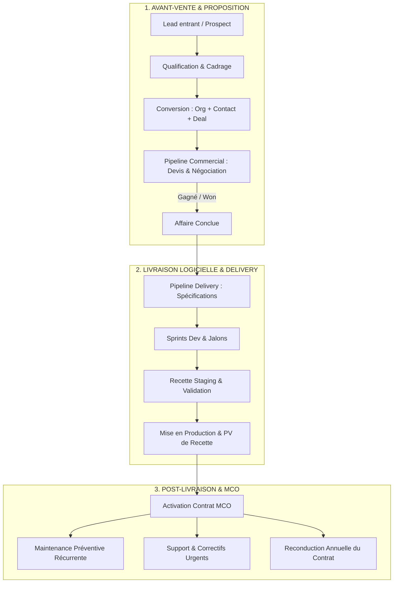
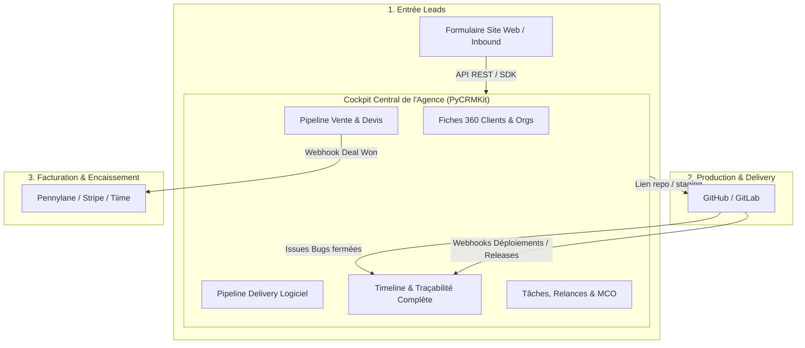

# Analyse Exhaustive : Gestion du Cycle de Vie Client d'une Agence Web Solo avec PyCRMKit

> **Document de Référence Métier & Architecture**  
> **Auteur** : Thomas Awounfouet / WebTech Forge  
> **Cible** : Développeur solo, artisan du logiciel, fondateur d'agence web ou studio tech  
> **Version PyCRMKit** : >= 1.2.0  
> **Statut** : Validé & Conforme à l'Architecture Hexagonale

---

## 1. Contexte & Problématique Métier

En tant que **développeur solo dirigeant une agence web**, vous portez simultanément plusieurs casquettes :
1. **Commercial / Avant-vente** : Prospection, recueil du besoin, cadrage fonctionnel et budgétaire, émission de devis, relances.
2. **Chef de Projet & Développeur** : Spécifications techniques, développements (sprints), revues intermédiaires, recette client, déploiements staging et production.
3. **Garant du MCO & Support** : Maintien en Conditions Opérationnelles, correctifs de bugs, mises à jour de sécurité, monitoring, renouvellement des contrats de maintenance.

### Pourquoi un CRM standard échoue pour ce profil
* Les solutions SaaS d'entreprise (Salesforce, HubSpot) sont **lourdes, coûteuses, fermées et déconnectées du code source**.
* Les outils de gestion de projet (Jira, Trello, Linear) ne savent pas gérer un compte client, un prévisionnel de chiffre d'affaires, ni un historique contractuel.
* Les devis et coordonnées finissent éparpillés entre Notion, des fichiers tableurs, des emails et des dépôts Git.

### La réponse de PyCRMKit
**PyCRMKit** fournit un socle CRM **headless, scriptable et pilotable en CLI (`pck`)**. Grâce à son architecture DDD et ses modules découplés (Leads, Contacts, Organisations, Pipelines multi-processus, Tâches, Custom Fields, Timeline, Tags, Webhooks), il permet de centraliser **l'intégralité du cycle relationnel sans quitter son terminal de dev**.

---

## 2. Déroulé Chronologique du Cycle Client



#### Équivalent Schéma ASCII :
```text
┌─────────────────────────────────────────────────────────────────────────────┐
│                       1. AVANT-VENTE & PROPOSITION                          │
│                                                                             │
│   [ Lead entrant / Prospect ]                                               │
│                 │                                                           │
│                 ▼                                                           │
│   [ Qualification & Cadrage ]                                               │
│                 │                                                           │
│                 ▼                                                           │
│   [ Conversion : Org + Contact + Deal ]                                     │
│                 │                                                           │
│                 ▼                                                           │
│   [ Pipeline Commercial : Devis & Négociation ]                             │
│                 │                                                           │
│                 ▼ (Gagné / Won)                                             │
│   [ Affaire Conclue ]                                                       │
└─────────────────┼───────────────────────────────────────────────────────────┘
                  │
                  ▼
┌─────────────────┼───────────────────────────────────────────────────────────┐
│                 ▼     2. LIVRAISON LOGICIELLE & DELIVERY                    │
│                                                                             │
│   [ Pipeline Delivery : Spécifications & Architecture ]                     │
│                 │                                                           │
│                 ▼                                                           │
│   [ Sprints Dev Backend/Frontend & Jalons ]                                 │
│                 │                                                           │
│                 ▼                                                           │
│   [ Recette Staging & Validation Client ]                                   │
│                 │                                                           │
│                 ▼                                                           │
│   [ Mise en Production & PV de Recette Définitive ]                         │
└─────────────────┼───────────────────────────────────────────────────────────┘
                  │
                  ▼
┌─────────────────┼───────────────────────────────────────────────────────────┐
│                 ▼          3. POST-LIVRAISON & MCO                          │
│                                                                             │
│   [ Activation Contrat MCO (Forfait mensuel & SLA) ]                        │
│         │                         │                         │               │
│         ▼                         ▼                         ▼               │
│  [ Maintenance            [ Support & Correctifs     [ Reconduction         │
│    Préventive Récurrente ]   Urgents / Incidents ]     Annuelle du Contrat ]│
└─────────────────────────────────────────────────────────────────────────────┘
```

---

## 3. Analyse Détaillée par Phase Métier

### 3.1. Phase 1 : Prospection, Cadrage & Proposition Commerciale

#### Couverture fonctionnelle : **100% Native**

Cette phase correspond au cœur de métier d'un CRM commercial.

* **Ingestion et Qualification des Prospects (`crm.leads`)** :
  * Capture des demandes arrivant par formulaire web, email ou recommandations réseau.
  * Stockage des coordonnées, de la source du lead (`website`, `referral`, `linkedin`) et du score d'appétence.
  * Suivi du statut de qualification : `NEW` ➔ `CONTACTED` ➔ `QUALIFIED` (ou `LOST` si hors budget/hors scope).

* **Cadrage technique et Comptes-rendus d'ateliers (`crm.timeline` / `crm.activities`)** :
  * Enregistrement des notes de cadrage : `📝 Note : Spécifications MVP plateforme SaaS`.
  * Historisation des réunions de cadrage : `📅 Réunion : Définition des besoins d'authentification et architecture multi-tenant`.

* **Conversion Atomique (`crm.leads.convert()`)** :
  * En une seule opération métier, le lead qualifié est transformé en :
    1. Une **Organisation** (l'entreprise cliente).
    2. Un **Contact** principal (le décideur / commanditaire).
    3. Une **Opportunité commerciale** (le devis / projet).

* **Cycle de Négociation & Devis (`crm.pipelines` & `crm.opportunities`)** :
  * Pipeline commercial configuré sur-mesure pour une agence :
    * `qualification` : Diagnostic préliminaire.
    * `cadrage_technique` : Rédaction des spécifications et chiffrage.
    * `devis_envoye` : Envoi de la proposition tarifaire.
    * `negociation` : Ajustements périmètre / budget.
    * `won` : Contrat validé / Acompte versé.
  * Gestion du montant (€), de la devise, et calcul de la valeur pondérée selon la probabilité de signature dans le cockpit exécutif (`pck dashboard`).

* **Relances et Discipline Commerciale (`crm.tasks`)** :
  * Création de rappels avec date limite stricte : `pck tasks create --title "Relance devis v1" --priority HIGH --due "2026-11-05"`.

---

### 3.2. Phase 2 : Livraison & Delivery du Produit Logiciel

#### Couverture fonctionnelle : **Très bien couvert via Multi-Pipelines & Métadonnées**

Généralement, les CRM s'arrêtent à la signature du devis. PyCRMKit permet d'étendre la gouvernance au delivery logiciel grâce à deux mécaniques puissantes :

#### A. Le « Pipeline de Delivery »
PyCRMKit permet d'instancier plusieurs pipelines en parallèle. Vous pouvez donc créer un pipeline opérationnel `agency-software-delivery` :

```text
[1. Spécifications & Design] ➔ [2. Sprint Dev Backend/Frontend] ➔ [3. Recette Staging] ➔ [4. Déploiement Prod] ➔ [5. Recette Définitive]
```

L'opportunité gagnée ou un ticket de livraison associé progresse d'étape en étape via la CLI :
```bash
pck sales move <deal-id> recette_staging --pipeline agency-software-delivery
```

#### B. Les Métadonnées Techniques sur la Fiche Client (`crm.custom_fields`)
Pour chaque client ou projet, vous stockez directement les informations d'infrastructure et de code dans la fiche organisation :
* `repo_git` : `"https://github.com/mon-agence/client-webapp"`
* `url_staging` : `"https://staging.client-app.fr"`
* `url_production` : `"https://app.client.fr"`
* `stack_technique` : `"Django 5.2 / React 19 / PostgreSQL"`
* `hebergement` : `"Hetzner Cloud VPS-04 (IP: 185.xxx.xxx.xxx)"`
* `budget_jours_homme` : `25` (entier)
* `contact_tech_client` : `"Thomas Durand (CTO client)"`

#### C. Les Jalons de Livraison (`crm.tasks`)
Suivi opérationnel des étapes clés avec alertes visuelles :
* `[Jalon] Livraison v1.0 sur environnement de Staging`
* `[Client] Démo de validation Sprint 2`
* `[Prod] Migration de base de données & Déploiement initial`
* `[PV] Signature du Procès-Verbal de recette définitive`

#### D. Intégration CI/CD & Événements Système (`crm.webhooks`)
Lorsqu'une pipeline GitHub Actions ou GitLab CI déploie une version en staging ou en production, un webhook ou un appel SDK Python peut automatiquement poster une entrée dans la **Timeline** du client :
```text
⚙️ Déploiement v1.2.0 effectué avec succès sur Staging par GitHub Actions
```

---

### 3.3. Phase 3 : Suivi Post-Livraison, Garantie & MCO

#### Couverture fonctionnelle : **Excellente pour le contrat, les SLA et la maintenance préventive**

Le MCO (Maintien en Conditions Opérationnelles) est le cœur de la récurrence financière (MRR) d'une agence web.

#### A. Pilotage Contractuel et Niveaux de Service (SLA)
Grâce aux `custom_fields` et aux `tags`, le dev solo dispose d'une fiche client 360° complète :
* **Champs contractuels** :
  * `mco_forfait_mensuel` : `"10h incluses / mois"`
  * `mco_taux_horaire_sup` : `"85 €/h"`
  * `mco_date_renouvellement` : `"2027-04-30"` (permet d'anticiper la reconduction tacite)
  * `mco_sla_gti` : `"GTI 4h ouvrées (Garantie de Temps d'Intervention)"`
  * `mco_monitoring_url` : `"https://betteruptime.com/report/xxx"`
* **Badges et Tags visuels (`pck orgs show`)** :
  * `#mco-actif` (Vert) : Contrat en cours de validité.
  * `#garantie-active` (Bleu) : Période de garantie légale post-livraison (3 mois).
  * `#support-vip` (Or) : Client prioritaire à réponse sous 2h.
  * `#mco-resilie` (Rouge) : Client sorti du parc de maintenance.

#### B. Maintenance Préventive Récurrente
Le dev solo planifie ses vérifications mensuelles via `crm.tasks` :
* Début de mois : *« Audit mensuel de sécurité dépendances (uv / pip audit / npm audit) »*.
* Trimestre : *« Test à blanc de restauration des sauvegardes PostgreSQL »*.
* Annuel : *« Vérification et renouvellement des certificats SSL / noms de domaine »*.

Chaque intervention terminée est journalisée avec son temps passé dans la `crm.timeline`.

#### C. Demandes de Support et Correctifs
* Les demandes urgentes sont créées dans `pck tasks` avec priorité `URGENT` et statut `IN_PROGRESS`.
* À la résolution, l'intervention est clôturée et consignée. Le client peut recevoir un compte-rendu d'intervention généré depuis la timeline.

---

## 4. Matrice d'Adéquation Fonctionnelle Exhaustive

| Périmètre Métier | Besoin Concret Agence Web Solo | Prise en charge dans PyCRMKit | Mécanisme / Commande |
|---|---|---|---|
| **Capture de prospects** | Ingestion formulaire de contact / emails | ✅ **Natif** | `crm.leads.create()` / `pck leads` |
| **Qualification commerciale** | Score, budget indicatif, faisabilité | ✅ **Natif** | Statuts `LeadStatus` (`NEW`, `QUALIFIED`) |
| **Cadrage technique initial** | Stocker les besoins, notes de cadrage | ✅ **Natif** | `crm.timeline` (Notes, Réunions) |
| **Transformation prospect ➔ client** | Créer compte, contact et opportunité | ✅ **Natif** | `crm.leads.convert()` |
| **Suivi du devis / négociation** | Pipeline commercial avec montants et probabilités | ✅ **Natif** | `crm.opportunities` / `pck sales move` |
| **Suivi du prévisionnel CA** | Tableau de bord commercial et taux de closing | ✅ **Natif** | `pck dashboard` |
| **Pilotage des sprints de dev** | Suivre l'avancement de la réalisation | ✅ **Natif via multi-pipelines** | Pipeline `agency-software-delivery` |
| **Documentation technique client** | Stocker Git repo, URL staging, stack | ✅ **Natif via custom fields** | `crm.custom_fields` sur Organisation |
| **Jalons de recette et validation** | PV de recette, validation mise en prod | ✅ **Natif** | `crm.tasks` avec dates d'échéance |
| **Traçabilité des déploiements** | Journaliser les livraisons de code | ✅ **Natif via webhooks / SDK** | Webhook CI/CD ➔ `crm.timeline` |
| **Contrat MCO et Forfait d'heures** | Forfait mensuel, date de renouvellement | ✅ **Natif via custom fields** | `custom_fields` (`mco_forfait`, etc.) |
| **SLA et Priorisation support** | Identifier les clients prioritaires | ✅ **Natif via tags** | `#support-vip`, `#mco-actif` |
| **Interventions de maintenance** | Traçabilité des patchs et correctifs | ✅ **Natif** | Tâches de maintenance + Timeline |
| **Ticketing d'incident lourd (Helpdesk)** | Portail d'ouverture de tickets par le client | ⚠️ **Intégration recommandée** | GitHub Issues / Linear relié par Webhook |
| **Facturation comptable / Mandat SEPA** | Facture PDF avec TVA et paiement bancaire | ⚠️ **Intégration recommandée** | Stripe / Pennylane / Tiime sur événement `Won` |
| **Décompte du temps à la seconde** | Minuteur de session de dev en continu | ⚠️ **Outil tiers recommandé** | Toggl / Harvest / WakaTime |

---

## 5. Architecture d'Intégration Conseillée pour l'Agence

PyCRMKit se positionne comme le **cockpit centralisateur (Single Source of Truth)**. Il est entouré de vos outils de développeur spécialisés :



#### Équivalent Schéma ASCII :
```text
                       ┌────────────────────────────────────────┐
                       │           1. ENTRÉE LEADS              │
                       │   Formulaire Site Web / Réseau Inbound │
                       └───────────────────┬────────────────────┘
                                           │
                                           │ (API REST / SDK / CLI)
                                           ▼
┌─────────────────────────────────────────────────────────────────────────────────────────┐
│                       COCKPIT CENTRAL DE L'AGENCE (PyCRMKit)                            │
│                                                                                         │
│   [( Fiches 360° Clients & Orgs )]          [ Pipeline Vente & Devis ]                  │
│                  │                                       │                              │
│                  ▼                                       │ (Webhook Deal Won)           │
│   [ Pipeline Delivery Logiciel ]                         ▼                              │
│                  │                         ┌─────────────────────────────┐              │
│                  ▼                         │ 3. FACTURATION / PAIEMENT   │              │
│   [ Timeline & Traçabilité Complète ]◄──┐  │ (Pennylane, Stripe, Tiime)  │              │
│                  ▲                      │  └─────────────────────────────┘              │
│                  │                      │                                               │
│   [ Tâches, Relances & MCO ]            │ (Webhooks Déploiements / Releases / Issues)   │
└──────────────────┼──────────────────────┼───────────────────────────────────────────────┘
                   │                      │
                   │ (Lien repo/staging)  │
                   ▼                      │
┌─────────────────────────────────────────┴───────────────┐
│               2. PRODUCTION & DEVOPS                    │
│                  GitHub / GitLab                        │
└─────────────────────────────────────────────────────────┘
```

---

## 6. Guide Pratique : Le Cycle Complet en Commandes CLI (`pck`)

Voici le déroulé pas à pas d'un projet client type en ligne de commande :

### Étape 1 : Le prospect contacte l'agence
```bash
# Capture du lead avec ses coordonnées et son besoin
pck leads create \
    --name "Alexandre Martin" \
    --org "Krono Logistics" \
    --email "a.martin@kronologistics.com" \
    --phone "+33 6 12 34 56 78" \
    --source "Site Web"
```

### Étape 2 : Cadrage et conversion en opportunité
```bash
# Cadrage validé -> conversion automatique du lead
pck leads convert <lead-id> --deal-name "Refonte Plateforme de Tracking" --amount 18500 --currency EUR
```

### Étape 3 : Négociation et clôture de la vente
```bash
# Visualisation des affaires en cours
pck sales opps

# Déplacement du deal après validation du devis par le client
pck sales move <deal-id> won
```

### Étape 4 : Lancement du projet dans le pipeline de Delivery
```bash
# Déplacement dans le pipeline de réalisation logicielle
pck sales move <deal-id> sprint_dev --pipeline agency-software-delivery

# Ajout des métadonnées techniques sur l'organisation
pck orgs update <org-id> \
    --custom "repo_git:https://github.com/mon-agence/krono-tracking" \
    --custom "url_staging:https://krono-staging.mon-agence.dev" \
    --custom "stack:Django 5.2 / React 19 / PostgreSQL"
```

### Étape 5 : Livraison, recette et déploiement
```bash
# Création des jalons de livraison
pck tasks create \
    --title "Déploiement v1.0.0 sur environnement de Staging" \
    --entity-id <org-id> \
    --priority HIGH \
    --due "2026-11-20"

# Une fois la recette validée :
pck sales move <deal-id> mise_en_prod --pipeline agency-software-delivery
```

### Étape 6 : Activation du MCO post-livraison
```bash
# Attribution des tags de maintenance
pck orgs tag <org-id> add "mco-actif" "support-vip"

# Renseignement du contrat de MCO
pck orgs update <org-id> \
    --custom "mco_forfait:8h / mois" \
    --custom "mco_taux_horaire:90 EUR/h" \
    --custom "mco_sla:GTI 4h ouvrées" \
    --custom "mco_date_anniversaire:2027-11-30"

# Planification du premier audit de maintenance
pck tasks create \
    --title "[MCO] Audit mensuel de sécurité et patch dépendances" \
    --entity-id <org-id> \
    --priority NORMAL \
    --due "2026-12-05"
```

### Étape 7 : Suivi quotidien dans le Cockpit Exécutif
```bash
# Diagnostic synthétique et KPIs
pck dashboard

# Fiche complète 360° du client avec timeline et tâches
pck orgs show <org-id>
```

---

## 7. Recette Python Prête à l'Emploi pour Studio Web

Ce script d'initialisation configure les pipelines et champs personnalisés pour votre agence :

```python
"""Configuration initiale des pipelines et métadonnées d'une agence web avec PyCRMKit."""

from pycrmkit.core.primitives import Money
from pycrmkit.facade.crm import CRM

def setup_web_agency_crm(crm: CRM) -> None:
    # 1. Pipeline Vente
    sales_pipeline = crm.pipelines.create(
        name="Agence - Vente & Avant-Projet",
        stages=[
            "qualification",      # Découverte du besoin
            "cadrage_technique",  # Estimation chiffrée
            "devis_envoye",       # En attente de signature
            "negociation",        # Ajustements
            "won",                # Signé / Acompte reçu
            "lost",               # Refusé
        ]
    )

    # 2. Pipeline Delivery Logiciel
    delivery_pipeline = crm.pipelines.create(
        name="Agence - Delivery Logiciel",
        stages=[
            "specifications",     # Architecture et maquettes
            "sprint_dev",         # Développement
            "recette_staging",    # Tests client sur environnement staging
            "mise_en_prod",       # Déploiement production
            "recette_definitive", # Signature PV & Clôture
        ]
    )

    # 3. Enregistrement des définitions de Custom Fields pour le MCO & Tech
    crm.custom_fields.define(entity_kind="organization", name="repo_git", field_type="string")
    crm.custom_fields.define(entity_kind="organization", name="url_staging", field_type="string")
    crm.custom_fields.define(entity_kind="organization", name="url_production", field_type="string")
    crm.custom_fields.define(entity_kind="organization", name="stack_technique", field_type="string")
    crm.custom_fields.define(entity_kind="organization", name="mco_forfait", field_type="string")
    crm.custom_fields.define(entity_kind="organization", name="mco_sla", field_type="string")
    crm.custom_fields.define(entity_kind="organization", name="mco_date_renouvellement", field_type="string")

    # 4. Tags d'agence
    crm.tags.create(name="mco-actif", color="#10B981")     # Vert
    crm.tags.create(name="garantie-active", color="#3B82F6") # Bleu
    crm.tags.create(name="support-vip", color="#F59E0B")     # Or
    crm.tags.create(name="prospect-chaud", color="#EF4444")  # Rouge

    print("✅ Configuration de l'environnement Agence Web terminée avec succès !")

if __name__ == "__main__":
    crm = CRM()
    setup_web_agency_crm(crm)
```

---

## 8. Conclusion

**PyCRMKit offre tout ce qui est nécessaire et suffisant** pour orchestrer la relation client d'une agence web ou d'un développeur freelance expérimenté :

1. **Aucun compromis sur la rigueur commerciale** : Les leads ne sont jamais perdus, les opportunités sont chiffrées avec prévisionnel et les relances sont cadencées.
2. **Continuité naturelle vers le code** : Grâce aux pipelines multi-étapes et aux métadonnées personnalisées, le projet de delivery et le contrat de MCO restent attachés à la même fiche 360° du client.
3. **Ergonomie développeur optimale (DX)** : Consultation instantanée depuis le terminal avec `pck dashboard` et `pck orgs show`, sans interface web lourde ni abonnement tiers.
4. **Intégrité architecturale** : Le CRM ne cherche pas à remplacer Git ni votre logiciel comptable, mais s'interface parfaitement avec eux via ses webhooks et son SDK Python.
