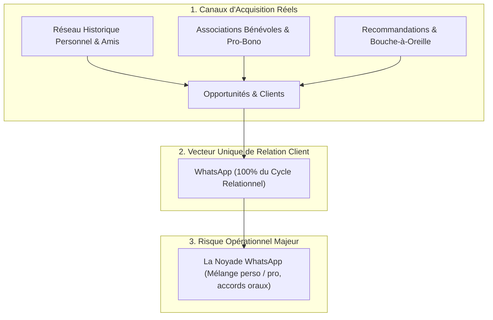

# Analyse Exhaustive : Pilotage d'une Agence Web Solo par WhatsApp & Réseau Chaud avec PyCRMKit

> **Document de Référence Métier, Stratégie & Architecture**  
> **Auteur** : Thomas Awounfouet / WebTech Forge  
> **Cible** : Développeur solo, artisan web indépendant, consultant technique  
> **Canal Principal d'Interaction** : WhatsApp (Messages, Vocaux, Appels Audio/Vidéo)  
> **Canaux Principaux d'Acquisition** : Réseau historique, Projets associatifs pro-bono, Recommandations (Bouche-à-oreille)  
> **Version PyCRMKit** : >= 1.2.0  
> **Statut** : Validé

---

## 1. La Réalité du Modèle : L'Agence Portée par la Proximité Humaine

Pour une grande majorité d'artisans développeurs et de créateurs d'agence web solo, le modèle commercial ne ressemble pas aux manuels marketing traditionnels. Il repose sur **trois piliers relationnels concrets** :



#### Équivalent Schéma ASCII :
```text
┌─────────────────────────────────────────────────────────────────────────┐
│                     1. CANAUX D'ACQUISITION RÉELS                       │
│                                                                         │
│   [ Réseau Historique Personnel & Amis ]                                │
│   (Témoins de l'évolution vers le dev)  ───────────┐                     │
│                                                    │                     │
│   [ Associations Bénévoles & Pro-Bono ]            ▼                     │
│   (Sites vitrines comme preuve concrète) ──► [ Opportunités & Clients ] │
│                                                    ▲                     │
│   [ Recommandations & Bouche-à-Oreille ]           │                     │
│   (Prescripteurs & clients satisfaits)  ───────────┘                     │
└────────────────────────────────────────────────────┬────────────────────┘
                                                     │
                                                     ▼
┌─────────────────────────────────────────────────────────────────────────┐
│                 2. VECTEUR UNIQUE DE RELATION CLIENT                    │
│                                                                         │
│   [ WhatsApp (100% du Cycle Relationnel) ]                              │
│     • Call de découverte audio/vidéo                                    │
│     • Présentation de services & audit technique                        │
│     • Devis PDF & accords par notes vocales                             │
│     • Points synchro, jalons & démos staging                            │
│     • Recette, livraison & mise en production                           │
│     • Support post-livraison & MCO                                      │
└────────────────────────────────────────────────────┬────────────────────┘
                                                     │
                                                     ▼
┌─────────────────────────────────────────────────────────────────────────┐
│                     3. RISQUE OPÉRATIONNEL MAJEUR                       │
│                                                                         │
│   [ La Noyade WhatsApp (Sans CRM Structurant) ]                         │
│     • Mélange discussions privées et contrats clients                   │
│     • Accords oraux et budgets oubliés dans les vocaux                  │
│     • Demandes MCO du week-end perdues sous le flux                     │
│     • Aucune visibilité globale sur le pipeline de CA                   │
└─────────────────────────────────────────────────────────────────────────┘
```

### Les forces de ce modèle
* **Taux de closing exceptionnel** : Le client a déjà confiance en vous avant même de parler budget. La barrière commerciale est levée.
* **Friction relationnelle zéro** : WhatsApp est instantané, accessible, mobile, direct et désinhibé.
* **Preuve tangible par le bénévolat** : Les sites web développés bénévolement pour des associations servent de vitrine fonctionnelle vivante, démontrant votre expertise sans discours creux.

---

## 2. Le Syndrome du « Tout-WhatsApp » sans CRM

Lorsque WhatsApp devient l'unique outil de travail de l'agence, des failles critiques apparaissent rapidement :

1. **La dilution de la frontière perso/pro** : Vos amis d'hier deviennent vos clients d'aujourd'hui. Les échanges oscillent constamment entre discussions informelles et exigences de livraison contractuelle.
2. **La perte de mémoire des accords contractuels** :
   * *« OK pour 4 000 €, lance les dev »* dit dans une note vocale de 3 minutes entre deux trajets.
   * Six mois plus tard, aucun devis signé n'est archivé, et le périmètre initial a dérivé (*scope creep*).
3. **Le trou noir du MCO (Maintenance)** :
   * Un client envoie un message un samedi soir : *« Salut Thomas, j'ai une erreur sur le panier »*.
   * Si vous n'ouvrez pas votre IDE immédiatement, le message est marqué comme lu et tombe dans l'oubli sous 20 nouveaux messages personnels le dimanche.
4. **L'aveuglement analytique** :
   * Quel prescripteur ou quelle association vous rapporte le plus de chiffre d'affaires ?
   * Quels sont les devis en attente de réponse cette semaine ?
   * Combien de temps a été consommé sur le forfait MCO du client X ce mois-ci ?

---

## 3. Comment PyCRMKit Répond à ce Modèle

PyCRMKit n'a pas vocation à remplacer WhatsApp ni à vous imposer un formulaire froid. Il se positionne comme **votre tour de contrôle et second cerveau**, structurant en arrière-plan tout ce qui se passe dans vos conversations.

```mermaid
flowchart LR
    subgraph Mobile ["Terrain & Relation Humaine"]
        direction TB
        WA_Call["Calls Audio / Vidéo"]
        WA_Msg["Notes Vocales & Messages"]
        WA_Doc["Envoi Devis PDF"]
    end

    subgraph Pont ["Le Pont des 30 Secondes"]
        direction TB
        CLI["CLI PyCRMKit (pck)"]
    end

    subgraph Cerveau ["PyCRMKit (Socle de Gestion)"]
        direction TB
        Rel["Relationships : Prescripteurs"]
        Ext["External Identities : WhatsApp ID"]
        Pipe["Pipelines Vente & Delivery"]
        Tasks["Tâches Prioritaires & MCO"]
        Hist["Timeline Chronologique"]
    end

    Mobile -->|"Formalisation instantanée"| CLI
    CLI --> Cerveau
    Cerveau --> Cockpit["Tableau de Bord : pck dashboard"]
```



#### Équivalent Schéma ASCII :
```text
┌───────────────────────────┐           ┌───────────────────┐           ┌───────────────────────────────────────────────┐
│ TERRAIN & RELATION HUMAINE│           │   LE PONT DE CLI  │           │           PYCRMKIT (SOCLE DE GESTION)         │
│        (WhatsApp)         │           │   (30 Secondes)   │           │               (Second Cerveau)                │
│                           │           │                   │           │                                               │
│ • Calls Audio / Vidéo     │           │                   │           │  [ Relationships : Prescripteurs & Réseau ]   │
│ • Notes Vocales & Messages│ ────────► │   pck (Terminal)  │ ────────► │  [ External Identities : Numéro WhatsApp ]    │
│ • Envoi Devis PDF         │  (Saisie  │                   │ (Mutation │  [ Pipelines Vente & Delivery Logiciel ]      │
│                           │  immédiate│                   │  atomique │  [ Tâches Prioritaires & Alertes MCO ]        │
│                           │   locale) │                   │  sécurisée│  [ Timeline Chronologique des Décisions ]     │
└───────────────────────────┘           └───────────────────┘           └───────────────────────┬───────────────────────┘
                                                                                                │
                                                                                                ▼
                                                                                ┌───────────────────────────────┐
                                                                                │     TABLEAU DE BORD GLOBAL    │
                                                                                │        (pck dashboard)        │
                                                                                └───────────────────────────────┘
```

### 3.1. Gestion des Prescripteurs et de l'Origine des Clients

PyCRMKit permet de tracer précisément d'où vient chaque euro de votre chiffre d'affaires :

* **Sources de leads personnalisées (`crm.leads`)** :
  * `source="whatsapp_reseau"` : Contact direct issu du carnet d'adresses personnel.
  * `source="asso_benevole"` : Contact ayant vu le site développé pour l'association.
  * `source="bouche_a_oreille"` : Recommandation d'un tiers.

* **Réseau de recommandation ([`RelationshipsAPI`](../guides/05_relationships.md))** :
  Vous pouvez relier formellement le prescripteur au nouveau client :
  ```python
  crm.relationships.create(
      source=EntityReference("contact", contact_prescripteur.id),
      target=EntityReference("contact", contact_nouveau_client.id),
      relationship_type="referred_by",
      role="Prescripteur / Recommandation",
      metadata={"contexte": "Rencontré lors de l'assemblée générale de l'association"}
  )
  ```
  *Bénéfice* : Vous savez exactement quels contacts de votre réseau sont vos meilleurs apporteurs d'affaires pour les soigner (cadeaux de fin d'année, commissions, invitations).

### 3.2. Rattachement de l'Identité WhatsApp ([`ExternalIdentitiesAPI`](../guides/17_external_identities.md))

Chaque fiche contact et organisation peut être indexée par son numéro WhatsApp au format E.164 :
```python
crm.external_identities.attach(
    contact,
    system="whatsapp",
    external_id="+33612345678",
    metadata={"preferred": True, "display_name": "Julien (Asso Solidarité)"}
)
```
Dans votre CLI, vous retrouvez un contact instantanément par son numéro de téléphone ou son nom de contact WhatsApp.

### 3.3. Formalisation des Notes Vocales et des Échanges WhatsApp

Au lieu de laisser les informations s'évanouir dans le fil WhatsApp, vous les consignez dans la **Timeline** du compte :

| Type d'Échange WhatsApp | Action de Structuration PyCRMKit | Rendu Fiche Client (`pck orgs show`) |
|---|---|---|
| **Call de découverte WhatsApp (30 min)** | Enregistrement d'une activité `CALL` avec synthèse des besoins | `📞 Appel : Call découverte WhatsApp - Besoin refonte e-commerce` |
| **Note vocale de cadrage** | Enregistrement d'une `NOTE` avec les points d'accord | `📝 Note : Accord verbal sur budget 4 500 € et délai au 15 décembre` |
| **Validation intermédiaire sur Staging** | Déplacement dans le pipeline commercial ou de delivery | `⚙️ Pipeline : Deal déplacé à [Recette Staging]` |
| **Signalement d'un bug un week-end** | Création d'une `TASK` prioritaire datée pour le lundi | `🚨 Tâche : [MCO] Erreur formulaire paiement (signalé par vocal)` |

---

## 4. Le Workflow au Quotidien : « La Règle des 30 Secondes »

Pour un développeur solo, le danger est de passer trop de temps à remplir son CRM.  
La solution est **la règle des 30 secondes** : chaque événement WhatsApp marquant fait l'objet d'une commande CLI immédiate.

### Étape 1 : Le message entrant d'un contact WhatsApp
Un ancien collègue ou un membre d'une association vous écrit :  
*« Salut Thomas ! J'ai vu le site que tu as fait pour l'asso, c'est super propre. J'aurais besoin d'une app web pour ma boîte, t'es dispo pour en parler ? »*

```bash
# 30 secondes dans le terminal :
pck leads create \
    --name "Sylvain Barret" \
    --org "Barret Conseil" \
    --phone "+33688990011" \
    --source "asso_benevole"
```

### Étape 2 : Le call de cadrage WhatsApp
Vous passez un appel audio ou vidéo de 20 minutes sur WhatsApp. Le besoin est qualifié, le budget de 5 000 € est validé verbalement.

```bash
# 30 secondes après avoir raccroché :
pck leads convert <lead-id> \
    --deal-name "Plateforme Web Barret Conseil" \
    --amount 5000 \
    --currency EUR

pck tasks create \
    --title "Envoyer devis PDF récapitulatif sur WhatsApp" \
    --priority HIGH \
    --due "2026-11-03"
```

### Étape 3 : La validation du devis par WhatsApp
Sylvain vous renvoie le devis signé ou un message : *« Devis signé et acompte viré ! »*

```bash
# 10 secondes :
pck sales move <deal-id> won
pck sales move <deal-id> specifications --pipeline agency-software-delivery
```

### Étape 4 : Les points synchro réguliers pendant le développement
Pendant le sprint, vous envoyez des captures et le lien staging sur WhatsApp. À chaque jalon :

```bash
pck sales move <deal-id> recette_staging --pipeline agency-software-delivery
pck tasks create --title "Call WhatsApp validation recette finale" --due "2026-11-25"
```

### Étape 5 : La bascule en MCO (Maintenance)
Le produit est en ligne. Le client souhaite que vous assuriez la maintenance (mises à jour de sécurité, monitoring, assistance réactive).

```bash
# 20 secondes :
pck orgs tag <org-id> add "mco-actif" "reseau-historique"
pck orgs update <org-id> \
    --custom "mco_forfait:6h / mois" \
    --custom "mco_sla:GTI 4h ouvrées" \
    --custom "canal_support:WhatsApp Prioritaire"

# Programmation du premier check de maintenance
pck tasks create \
    --title "[MCO] Audit sécurité mensuel & backups" \
    --entity-id <org-id> \
    --priority NORMAL \
    --due "2026-12-05"
```

---

## 5. Pourquoi NE PAS brancher de Chatbot WhatsApp Automatique

Il peut être tentant d'automatiser WhatsApp avec un bot (Twilio, Meta Business API) pour répondre aux clients.  
**C'est une erreur stratégique majeure pour un artisan développeur solo.**

| Approche Robotisée (Chatbot) | Approche Artisanale Structurée (PyCRMKit) |
|---|---|
| Le client reçoit : *« Tapez 1 pour le support, tapez 2 pour un devis »*. | Le client parle directement avec le fondateur et expert technique. |
| **Brise la relation de confiance** construite dans l'association ou le réseau personnel. | **Renforce la fidélité** par une écoute bienveillante et humaine. |
| Réponses rigides et inadaptées aux subtilités de négociation d'une agence. | Vous pilotez la discussion avec souplesse et empathie. |
| Risque de bannissement du numéro ou coûts d'API Meta récurrents. | **Zéro coût**, contrôle 100% local et sécurisé dans votre terminal. |

> [!IMPORTANT]
> **Le secret de l'artisan du web** :  
> Vos clients payent pour **votre personne** et pour la sérénité d'avoir un interlocuteur unique et compétent.  
> Laissez WhatsApp être le salon de discussion chaleureux ; faites de PyCRMKit votre bureau d'ingénieur rigoureux.

---

## 6. Configuration Python Spécifique Réseau & WhatsApp

Voici le module d'initialisation recommandé pour orchestrer ce profil dans PyCRMKit :

```python
"""Configuration de l'environnement PyCRMKit pour une agence portée par WhatsApp et le réseau."""

from pycrmkit.core.references import EntityReference
from pycrmkit.facade.crm import CRM


def setup_whatsapp_network_agency(crm: CRM) -> None:
    # 1. Custom fields d'infrastructure relationnelle
    crm.custom_fields.define(entity_kind="contact", name="whatsapp_phone", field_type="string")
    crm.custom_fields.define(entity_kind="contact", name="contexte_rencontre", field_type="string")
    crm.custom_fields.define(entity_kind="organization", name="mco_forfait", field_type="string")
    crm.custom_fields.define(entity_kind="organization", name="mco_sla", field_type="string")

    # 2. Tags d'identification de la relation
    crm.tags.create(name="reseau-perso", color="#3B82F6")     # Bleu
    crm.tags.create(name="asso-benevole", color="#10B981")    # Vert
    crm.tags.create(name="prescripteur-vip", color="#F59E0B") # Or
    crm.tags.create(name="mco-actif", color="#059669")        # Emeraude

    # 3. Pipelines Vente et Delivery
    crm.pipelines.create(
        name="Vente - Réseau & WhatsApp",
        stages=[
            "decouverte_whatsapp",
            "cadrage_technique",
            "devis_envoye",
            "won",
            "lost",
        ],
    )

    crm.pipelines.create(
        name="Delivery Logiciel",
        stages=[
            "specifications",
            "sprint_dev",
            "recette_staging",
            "mise_en_prod",
            "mco_garantie",
        ],
    )

    print("🚀 Environnement WhatsApp & Réseau initialisé avec succès dans PyCRMKit.")


if __name__ == "__main__":
    crm = CRM()
    setup_whatsapp_network_agency(crm)
```

---

## 7. Synthèse et Recommandations Finales

1. **Continuez à utiliser WhatsApp pour ce qu'il fait de mieux** : la proximité, la rapidité, l'humanité et la négociation sans friction.
2. **Utilisez PyCRMKit pour ce que WhatsApp est incapable de faire** :
   * Conserver la mémoire des devis et des étapes de livraison.
   * Planifier les alertes de maintenance pour ne jamais délaisser un client MCO.
   * Visualiser votre chiffre d'affaires et identifier les prescripteurs qui font vivre votre studio.
3. **Adoptez la règle des 30 secondes en CLI (`pck`)** : Une commande rapide après chaque conversation importante garantit un suivi professionnel sans aucune charge mentale.
